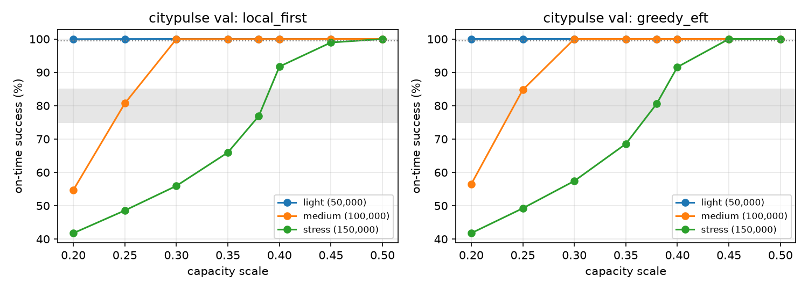

# Simulator: specification, validation, calibration, and rule-based baselines

Every scheduler in this project (the EdgePlus reproduction, its baselines, rule-based dispatchers, and EdgePlus-PEC) runs in this simulator. Same code, same task streams, same random draws.

- Code: `src/edgesim/sim/` (`env.py` is the core), dispatchers in `src/edgesim/agents/heuristics.py`.
- Settings: `configs/sim.yaml` (simulator), `configs/topology.yaml` (servers), `configs/systems.yaml` (system presets), `configs/workload.yaml` (tasks).
- EdgePlus equation numbers refer to the base paper (Taher et al., IEEE Internet of Things Journal, 2026).

---

## Contents

1. [What is simulated](#1-what-is-simulated)
2. [Servers and queues](#2-servers-and-queues)
3. [Candidates and latency](#3-candidates-and-latency)
4. [Feasibility mask](#4-feasibility-mask)
5. [Slices, mobility, and ledger signals](#5-slices-mobility-and-ledger-signals)
6. [Predictors](#6-predictors)
7. [System presets](#7-system-presets)
8. [How we read EdgePlus where it is silent](#8-how-we-read-edgeplus-where-it-is-silent)
9. [Validation against queueing theory](#9-validation-against-queueing-theory)
10. [Capacity calibration](#10-capacity-calibration)
11. [Rule-based baselines](#11-rule-based-baselines)
12. [Using the simulator](#12-using-the-simulator)
13. [Limitations](#13-limitations)

---

## 1. What is simulated

- **Episode.** One task table from `scripts/prepare_data.py`: 50k, 100k, or 150k tasks arriving over 600 s. The simulation continues until every admitted task has finished.
- **Events.** For each arrival the simulator advances every server to the arrival time, refreshes slice budgets, computes predictions and the mask for all 32 servers, and asks the policy for a decision. Every 5 s it makes a slow decision (mobile moves, and slice shares in milestone M5), either with a built-in rule or by asking an external controller.
- **Common random numbers.** Each task gets a service-time factor, an uplink factor, and a driving factor drawn from the episode seed. The draws do not depend on the server or the scheduler, so paired comparisons between schedulers have low variance.
- **Speed.** About 7,000 to 8,000 decisions per second on one core. A 150k-task episode takes 20 to 45 s.

## 2. Servers and queues

| Kind | Count | Cores per server | Core speed | Memory | Notes |
|---|---|---|---|---|---|
| Stationary | 1 per site | 16 on average, proportional to the site's training-day task share (minimum 2) | 2.5 GHz × scale | 64 GB | CityPulse sites get 6 to 33 cores; AirDelhi sites 5 to 56 |
| Mobile | 2 per site | 8 | 2.0 GHz × scale | 32 GB | 120 km/h, 20 kWh battery |
| Cloud | 2 | 32 | 2.5 GHz × scale | 512 GB | a reserved quota behind a 1 Gbit/s backhaul and 50 ms one-way WAN delay |

- `capacity.scale = 0.38` (Section 10). Total capacity: 152 Gcycles/s stationary, 122 mobile, 61 cloud.
- **Multi-core queues (M/G/c).** A task runs on one core for `cycles / core speed × service factor`. The service factor is lognormal with mean 1 and σ = 0.25. Typical processing takes 1 to 3 s, close to EdgePlus's light-load latencies (median about 4 s).
- **Queue order.** Tasks wait until their data has arrived, then join the server queue in one of two orders:
  - `fifo`: by data arrival time (EdgePlus);
  - `slice_priority`: URLLC before eMBB before mMTC, FIFO within a slice, no preemption.
- **Memory.** A task holds its memory from assignment until it finishes, so a full server caps its own queue length.
- **Energy.** Uplink at 0.2 W; compute at 2, 3, and 1 × 10⁻¹¹ J per cycle (stationary, mobile, cloud); backhaul at 2 × 10⁻⁸ J/bit. Driving costs 540 J/m (about 0.15 kWh/km) and is reported separately, because one relocation outweighs the compute energy of thousands of tasks.

## 3. Candidates and latency

For a task from site `c`, the candidates follow EdgePlus's routing order:

| Tier | Candidates | Extra delay |
|---|---|---|
| 0 | stationary server of `c` | none |
| 1 | mobiles parked at `c`, or already driving to `c` | the remaining drive time |
| 2 | mobiles parked at a neighbouring site (any site when masks are off) | assigning a task relocates the mobile to `c`: distance × 1.3 / speed |
| 3 | cloud servers | shared backhaul queue plus WAN delay |

- **Latency** is `uplink + network + drive + queue wait + processing + result return`, following EdgePlus Eq. 1.
- **Uplink** time is `η_OH · b / R` with `R = ζ_k · W_k · log2(1 + SNR) · η_MAC · η_bh` (EdgePlus Eq. 30). Slice bandwidths are 100/400/20 MHz. SNR comes from the device's distance to its small cell (a uniform draw over a 300 m disc), and the uplink factor adds fading. Uplinks take milliseconds, so queueing dominates latency, as in EdgePlus.
- **Relocation.** A relocating mobile keeps processing the tasks already on board while it drives. It accepts new tasks only from its destination site, and their data uploads after it arrives.
- **Success** means the result is back by the deadline. Rejected or dropped tasks count as misses.

## 4. Feasibility mask

| Level | What it checks | Used by |
|---|---|---|
| `none` | physical only: candidate exists, memory fits, battery above 10% | ablations without masks (EdgePlus A5, A6) |
| `routing` | physical, plus tier 2 limited to neighbouring sites | diagnostics |
| `full` | routing, plus deadline (`t + bound ≤ d`), slice budget, and URLLC reputation quarantine | default |

When no server passes, the simulator decides by itself:

- `best_effort` (EdgePlus): the lowest predicted latency, preferring servers still predicted to meet the deadline.
- `reject` (EdgePlus+): drop the task only if no server is predicted to meet its deadline (a hopeless task); otherwise behave like `best_effort`.

With exactly one option and no reject action, the simulator also decides automatically. Each empty mask is logged with the check that emptied it (`empty_by_*` in the KPIs).

## 5. Slices, mobility, and ledger signals

- **Slice budgets** (EdgePlus Eq. 4, per window rather than per episode). Each site has one token bucket per slice for edge compute: refill = share × site capacity, cap = 10 s of refill. Compute shares are 0.15 / 0.75 / 0.10 (URLLC / eMBB / mMTC); eMBB carries about 86% of the compute demand. A second bucket set tracks radio airtime, which rarely binds because uplinks are short. Cloud work uses no edge budget.
- **Mobility.**
  - `distress` (EdgePlus's redeployment, with straight-line routes instead of CBS–D* Lite): every 5 s, a site with more than 10 s of queued work per core pulls the least-loaded mobile from a neighbour that has less than 2 s; at most 2 moves per step.
  - Tier-2 assignments also relocate mobiles.
  - `external` hands moves to an external controller.
- **Ledger signals** (EdgePlus Eqs. 14, 28):
  - reputation per server: EMA with weight 0.05 of +1 (on time) or −1 (late);
  - debt per site: average on-time throughput minus the site's own, floored at 0, with a 30 s EWMA.
  Reputation drives the URLLC quarantine (threshold 0.7). Both are recorded at assignment for reward shaping in M3. The hash chain itself is not simulated here; its cost is measured separately for OBJ7.

## 6. Predictors

| Predictor | Queue wait estimate | Where |
|---|---|---|
| `backlog` (default) | 0 if there are fewer busy and queued-ahead tasks than cores; otherwise expected remaining work ahead ÷ cores. Under slice priority, also divided by (1 − ρ of higher slices) to account for higher-priority work that arrives while the task waits. | EdgePlus (fair setting), EdgePlus+, EdgePlus-PEC |
| `kingman` | EdgePlus Eq. 31 in its M/G/c form (Sakasegawa): ρ^(√(2(c+1))−1) / (c(1−ρ)) · (c_a² + c_s²)/2 · E[S], using live utilization and online service statistics; ignores the current queue | `edgeplus_literal` |
| calibrated | `backlog` plus an adaptive conformal margin per (slice, server kind) | optional (`mask.calibrated`), not used in the main comparison |

The calibrated bound is `U = L̂ + q_g · max(L̂, 0.5 s)`:

- `q_g` is the (1 − α_g) quantile of recent relative errors (window 500, refreshed every 25 completions);
- α_g follows adaptive conformal inference with step 0.005;
- the target miss rates are 1% (URLLC), 5% (eMBB), and 10% (mMTC).

Smoke test on one CityPulse test episode with greedy EFT:

- At 100k tasks, the observed share of tasks exceeding their bound was 1.0%, 5.0%, and 10.0%: on target.
- At 150k it drifted to 1.0%, 10%, and 16% (URLLC, eMBB, mMTC), because load ramps up faster than the step size can follow. Tuning it is left open; the calibrated mask is not used in the main comparison.

Why `backlog` and not `kingman` for EdgePlus in the main comparison: on one CityPulse test episode, greedy EFT with the Kingman form drops from 100% to 98.7% success at 100k and from 78% to 69% at 150k. Its 95th-percentile prediction error grows from 5 s to 155 s, because the steady-state formula ignores the actual queue. Using it would weaken EdgePlus for reasons unrelated to learning. We report it as the literal variant.

## 7. System presets

`configs/systems.yaml`:

| Preset | Queue order | Empty mask | Reject action | Predictor |
|---|---|---|---|---|
| `edgeplus` | FIFO | best effort | no | backlog |
| `edgeplus_literal` | FIFO | best effort | no | Kingman |
| `edgeplus_plus` | slice priority | reject hopeless | no | backlog |
| `edgeplus_pec` | slice priority | best effort | no | backlog |

Presets change system features only; the scheduling policy is chosen separately. `edgeplus_pec` also changes mobility (serve in place, damped redeployment), adds DVFS, and shortens ledger timing. Its single-change variants (`edgeplus_pq`, `edgeplus_energy`, `edgeplus_cons`) are in `configs/systems.yaml` and described in the paper (`paper/EdgePlus-PEC.pdf`, Section VII).

## 8. How we read EdgePlus where it is silent

| Question | Our reading |
|---|---|
| Server counts and sizes | 1 stationary and 2 mobile per site, 2 cloud (read from EdgePlus Fig. 2). Cores and speeds are calibrated (Section 10). |
| Is the routing order strict? | No. It defines the candidate set, and any feasible candidate may be chosen. |
| What does `L_move` mean? | Relocating a mobile from a neighbouring site to the task's site. Mobiles parked at the task's site need no driving. |
| Slice budgets | Token buckets per 10 s window instead of totals over the whole horizon (EdgePlus Eq. 4). |
| Empty mask | Best effort: send to the server with the lowest predicted latency. |
| Deadline check for eMBB and mMTC | Applied to all slices (`mask.deadline: all`; `urllc` is available). |
| Ground truth for queues | Explicit queues with random service times. The paper's formula is available as a predictor only. |
| Throughput | On-time completions ÷ 600 s, which matches the arithmetic of EdgePlus Fig. 5 at 150k. |
| Locality | Share of executed tasks on tiers 0 and 1 (servers that were already at the task's site). |
| Jain fairness | Reported over per-site success rates, plus the literal version over per-site throughput. |

## 9. Validation against queueing theory

`scripts/validate_simulator.py` uses a single server with Poisson arrivals and no network. Each test has 5 seeds × 200,000 tasks, with the first 10% discarded as warm-up. The table shows the mean wait in queue.

| Test | Cores | ρ | Theory (s) | Simulated (s) | Error |
|---|---|---|---|---|---|
| M/M/c FIFO (Erlang C) | 1 | 0.5 | 1.000 | 1.002 ± 0.010 | +0.2% |
| | 1 | 0.7 | 2.333 | 2.325 ± 0.035 | −0.4% |
| | 1 | 0.9 | 9.000 | 8.812 ± 0.200 | −2.1% |
| | 4 | 0.5 | 0.087 | 0.087 ± 0.002 | −0.4% |
| | 4 | 0.7 | 0.357 | 0.355 ± 0.008 | −0.7% |
| | 4 | 0.9 | 1.969 | 1.924 ± 0.048 | −2.3% |
| | 16 | 0.5 | 0.0011 | 0.0011 ± 0.0001 | 0.0% |
| | 16 | 0.7 | 0.027 | 0.026 ± 0.001 | −2.5% |
| | 16 | 0.9 | 0.370 | 0.360 ± 0.009 | −2.6% |
| M/G/1 FIFO (Pollaczek–Khinchine, lognormal σ = 1) | 1 | 0.5 | 1.359 | 1.334 ± 0.025 | −1.9% |
| | 1 | 0.7 | 3.171 | 3.090 ± 0.080 | −2.5% |
| | 1 | 0.9 | 12.232 | 11.668 ± 0.961 | −4.6% |
| M/M/1 priority, 2 classes (Cobham), high class | 1 | 0.8 | 1.333 | 1.334 ± 0.008 | 0.0% |
| M/M/1 priority, 2 classes (Cobham), low class | 1 | 0.8 | 6.667 | 6.603 ± 0.106 | −0.9% |

All errors are within 5%, and most are within the 95% interval. The small negative bias at ρ = 0.9 is the usual finite-run effect: queues start empty and heavy-load transients are long. Results: `results/summary/sim_validation.json`.

## 10. Capacity calibration

`scripts/calibrate_capacity.py` sweeps `capacity.scale` on CityPulse validation days with the `edgeplus` preset (3 seeds per point).

**Rule.** Pick the scale at which the routing-order heuristic reaches the regime EdgePlus reports: about 100% success at 50k tasks, and the paper's 79–83% band at 150k.

**Result.** At scale 0.38:
- 50k: 100% for local-first and greedy EFT.
- 100k: 100%.
- 150k: 76.9% (local-first) and 80.6% (greedy EFT).

Our medium regime is benign, whereas EdgePlus reports about 80% at 100k. EdgePlus reports almost the same violation rate at 100k (17.5%) as at 150k (17.2%), despite 50% more load at 150k, so we did not try to match its 100k result.



Overload sets in sharply: at 150k, success goes from 66% to 92% between scales 0.35 and 0.40. Near that edge the choice of scheduler matters most.

## 11. Rule-based baselines

`scripts/run_heuristics.py`, test days, 5 seeds (distinct test windows), mean ± 95% CI. Dispatchers:

- random feasible;
- local-first (EdgePlus routing order, lowest latency within a tier);
- least-loaded (shortest predicted wait);
- greedy EFT (earliest predicted finish);
- slack-aware (most local server that finishes with 25% of the slack to spare).

### Dataset A, CityPulse (the data EdgePlus used)

| Preset | Dispatcher | 50k | 100k | 150k | URLLC at 150k | Lp95 at 150k (s) | Cloud at 150k |
|---|---|---|---|---|---|---|---|
| edgeplus | greedy EFT | 100.0 | 100.0 | 80.6 ± 1.7 | 46.3 | 107 | 14.0% |
| edgeplus | local-first | 100.0 | 100.0 | 77.1 ± 1.7 | 41.4 | 123 | 13.8% |
| edgeplus | slack-aware | 100.0 | 100.0 | 77.3 ± 2.1 | 41.5 | 122 | 13.8% |
| edgeplus | least-loaded | 100.0 | 99.7 | 63.0 ± 0.1 | 15.7 | 147 | 17.3% |
| edgeplus | random feasible | 97.8 | 96.4 | 61.4 ± 0.3 | 11.9 | 144 | 27.4% |
| edgeplus_plus | slack-aware | 100.0 | 97.5 | 90.7 ± 0.5 | 100.0 | 247 | 13.9% |
| edgeplus_plus | local-first | 100.0 | 96.4 | 90.4 ± 0.7 | 100.0 | 278 | 13.8% |
| edgeplus_plus | greedy EFT | 100.0 | 100.0 | 89.9 ± 1.7 | 100.0 | 151 | 22.8% |

### Dataset B, AirDelhi (unseen city, same capacity)

| Preset | Dispatcher | 50k | 100k | 150k | URLLC at 150k | Lp95 at 150k (s) | Cloud at 150k |
|---|---|---|---|---|---|---|---|
| edgeplus | greedy EFT | 100.0 | 70.8 ± 7.0 | 54.9 ± 2.7 | 25.0 | 152 | 37.2% |
| edgeplus | local-first | 99.9 | 70.5 ± 8.3 | 54.7 ± 2.4 | 24.7 | 153 | 37.3% |
| edgeplus | random feasible | 98.3 | 66.8 ± 4.9 | 53.8 ± 2.0 | 24.1 | 152 | 40.7% |
| edgeplus_plus | slack-aware | 99.9 | 86.4 ± 3.7 | 72.3 ± 3.4 | 95.9 | 286 | 35.2% |
| edgeplus_plus | local-first | 99.8 | 86.5 ± 3.2 | 72.1 ± 3.0 | 96.0 | 277 | 35.3% |
| edgeplus_plus | greedy EFT | 100.0 | 85.3 ± 2.8 | 71.9 ± 3.1 | 96.2 | 290 | 36.3% |

Full tables (all KPIs, all dispatchers): `results/summary/heuristics_{citypulse,airdelhi}_test.json`.

### What the baselines show

1. **Simple rules sit inside EdgePlus's reported band.** Greedy EFT and local-first get 77–81% at 150k on CityPulse. EdgePlus's learned methods report 79.4–82.8% in Fig. 4. A learned EdgePlus therefore has to beat greedy EFT to show any value from learning.
2. **FIFO is what kills URLLC.** Under the EdgePlus preset, URLLC success is 41–46% at 150k while mMTC is near 100%: urgent tasks wait behind long eMBB queues. Priority queues and hopeless-task rejection (`edgeplus_plus`) raise URLLC to 100% and overall success to about 90%, with no learning. This is why EdgePlus+ exists, and why EdgePlus-PEC adds priority queues.
3. **Priority has a cost.** Under `edgeplus_plus`, mMTC drops to 86–93% at 150k (it is near 100% under FIFO) and Lp95 rises to 150–300 s: low-priority work starves. EdgePlus-PEC shows the same trade-off (paper, Section IX).
4. **Delhi is much harder at the same capacity.** Success at 150k falls to about 55% (EdgePlus preset) and 72% (EdgePlus+). For greedy EFT under the EdgePlus preset, 71% of tasks find an empty mask, 19% find every candidate's memory full, and 37% of executed tasks go to the cloud. The causes are bursty arrivals (arrival-rate CV 0.31) and one site carrying 35% of the training-day load. Spare capacity elsewhere goes unused because only mobiles can move it, and only to neighbouring sites.
5. **The dispatcher matters little once the system is overloaded.** On Delhi at 150k, all dispatchers under the same preset are within 1 pp (EdgePlus) to 2 pp (EdgePlus+) of each other. The large gains come from system design (queue order, admission, where capacity sits), which is why EdgePlus-PEC changes the system rather than the scheduler.

## 12. Using the simulator

```python
from edgesim.agents.heuristics import GreedyEFT
from edgesim.runner import episode_tasks, run_episode
from edgesim.sim.config import sim_config
from edgesim.sim.env import EdgeEnv
from edgesim.sim.world import load_world

env = EdgeEnv(load_world("citypulse"), sim_config("edgeplus"))
tasks = episode_tasks("citypulse", "test", 150_000, seed=0)
kpis = run_episode(env, GreedyEFT(), tasks, seed=0)
```

Custom loop (for learning agents):

```python
env.reset(tasks, seed=0)
while not env.done:
    kind, _ = env.request
    if kind == "fast":                 # one task waiting: env.cur_mask, env.cur_L, env.cur_tier, ...
        env.act(server_index)          # or env.REJECT when dispatch.allow_reject is on
    else:                              # slow step (mobility.mode: external)
        env.act_slow({"shares_compute": shares, "moves": [(server, site)]})
    for task in env.pop_completions(): # finished or rejected tasks, for delayed rewards
        ...
```

Commands:

```bash
python scripts/validate_simulator.py                        # queueing-theory checks (about 3 min)
python scripts/calibrate_capacity.py --dataset citypulse    # capacity sweep
python scripts/run_heuristics.py --dataset citypulse --regimes stress --seeds 0 1 2 3 4
```

`run_heuristics.py` prints one line per finished episode and merges runs of different regimes into one summary, so long grids can be split into chunks.

## 13. Limitations

- Mobiles drive in straight lines (× 1.3 for roads) instead of CBS–D* Lite on a risk grid. No collision constraints.
- A task runs on a single core. There is no preemption, no task splitting, and no dependencies between tasks.
- Radio is a link-budget formula with fading noise. There is no interference model or scheduler at the radio layer. Uplinks are milliseconds, so radio slices almost never bind.
- Batteries (20 kWh) never run low within a 600 s episode.
- Footprints (cycles, payload, memory per slice) and server sizes are our assumptions, because EdgePlus gives none. Capacity is calibrated on CityPulse only, and AirDelhi uses the same total capacity.
- Calibration margins drift under fast load ramps (Section 6). This is not addressed; the calibrated mask is not used in the main comparison.
