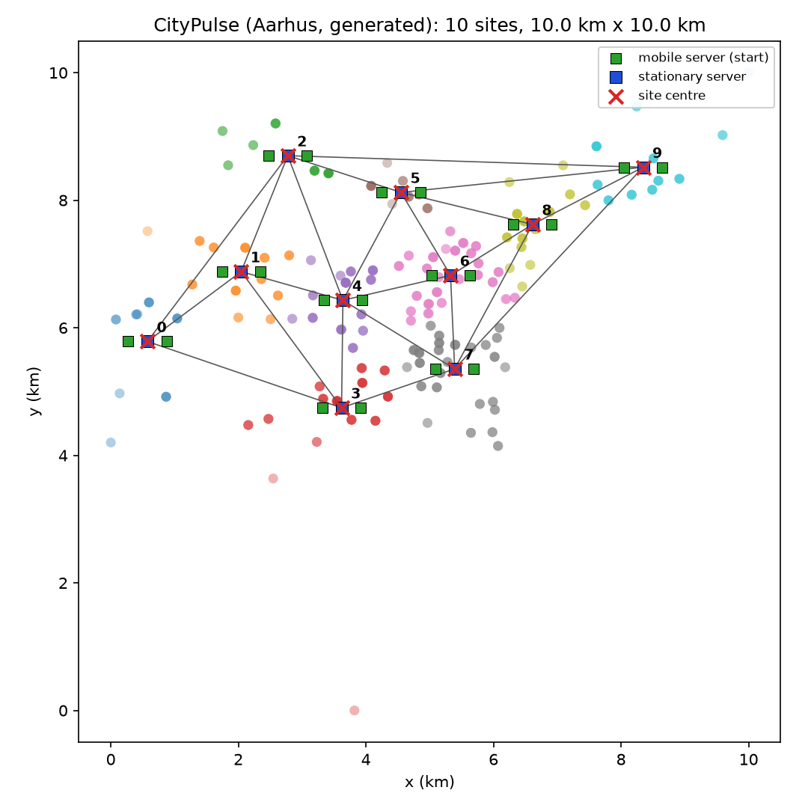
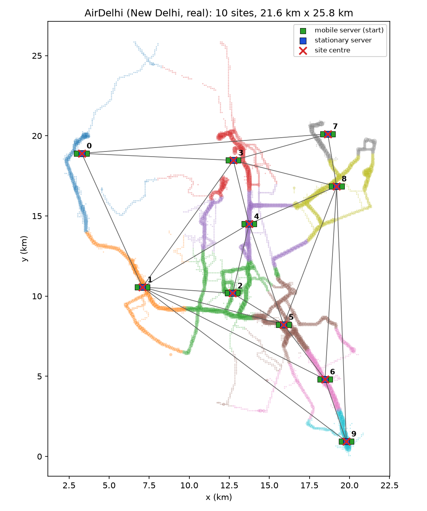
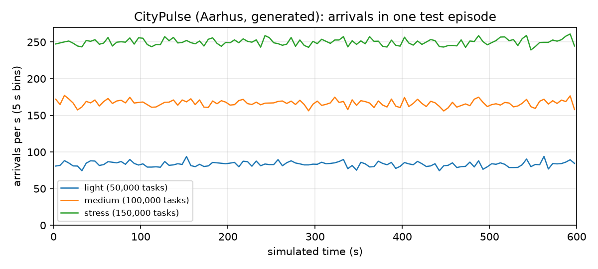
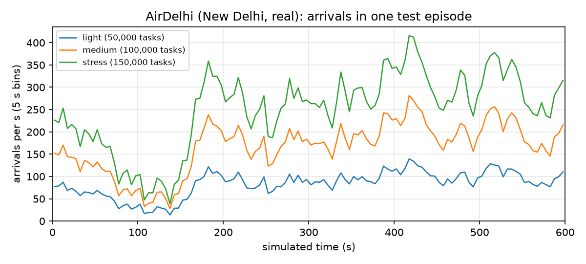
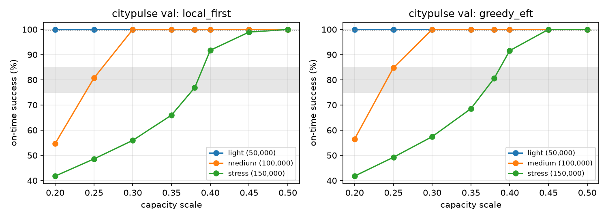
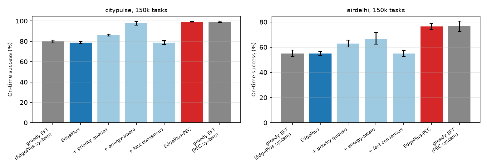
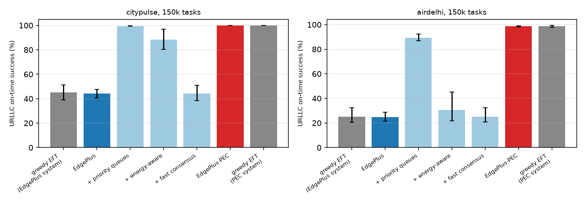
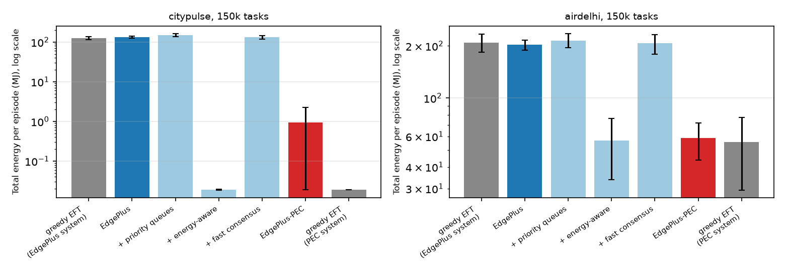

# EdgePlus-PEC: Priority Queues, Energy-Aware Mobility, and Fast Ledger Consensus for Deadline-Aware 6G Edge Scheduling

**Keerat Malhotra, Bhavya Maheshwari, Bhumika Aswal**

## Abstract

EdgePlus assigns deadline-constrained air-quality IoT tasks to stationary edge servers, mobile edge servers, and the cloud. It uses masked cooperative PPO (CCPPO), an advisory layer, a particle-swarm outer loop, and a lightweight ledger whose reputation and debt signals feed back into the scheduler. We reproduce EdgePlus in an open, event-driven simulator whose queueing engine matches queueing theory within 5%. We then extend it with three system-level changes that leave the scheduler untouched:

- **P:** slice-priority queues at servers.
- **E:** energy-aware execution and mobility. A neighbouring site's mobile server serves a task where it is parked instead of driving over, redeployment is damped, and edge cores use slack-based frequency scaling.
- **C:** faster ledger consensus, through time-bounded partial blocks and shorter cloud BFT rounds.

We call the result EdgePlus-PEC. Both systems are trained with the same CCPPO protocol (1.5 million decisions, three seeds) on CityPulse training days. They are evaluated frozen on held-out test days and, without retraining, on real bus-mounted sensor data from New Delhi (AirDelhi).

At 150,000 tasks per 10-minute episode, EdgePlus-PEC:

- raises on-time success from 78.8% to 99.3% on CityPulse and from 54.9% to 76.3% on AirDelhi;
- raises URLLC success from 44.1% to 100% and from 24.9% to 98.6%;
- cuts energy per episode from 133.0 MJ to 0.94 MJ and from 202.7 MJ to 58.7 MJ;
- commits ledger records within 0.50 s (95th percentile) instead of 19–24 s.

All 15 paired test episodes favour EdgePlus-PEC on these four measures, on both datasets. The gains come with lower mMTC success, a longer latency tail on AirDelhi, and about ten times more ledger CPU time. A greedy earliest-finish-time rule reaches the same success as the trained scheduler on both systems, which places the gains in the system design. Our EdgePlus reproduction reaches 78.8% success at the heaviest load, within 4 percentage points of the 82.77% reported.

**Index terms:** 6G edge computing, multi-agent reinforcement learning, task offloading, network slicing, priority scheduling, energy efficiency, blockchain consensus, reproducibility.

## 1 Introduction

Smart-city air-quality networks produce bursty streams of sensor readings that must be processed before deadlines that depend on urgency. EdgePlus [1] turns such readings into tasks in three 6G slices: URLLC with deadlines of 5–15 s, eMBB with 30–120 s, and mMTC with 120–600 s. It assigns each task to a stationary edge server, a mobile edge server, or the cloud.

Its scheduler is masked cooperative PPO (CCPPO): one actor per cluster and a centralized critic. Feasibility masks remove servers that would break the routing order, a slice budget, a resource limit, or the deadline. An advisory layer (Nash sharing, PID, leader election) biases the remaining choices, and a constricted particle swarm (PSO) tunes the advisory gains. A two-tier ledger (edge Proof of Authority, cloud BFT) produces reputation and debt signals that enter the state, the reward, and the URLLC mask. EdgePlus reports 82.77% on-time success at its heaviest load of 150,000 tasks.

Three properties of the EdgePlus *system*, rather than of its learner, limit what any scheduler can achieve on it:

1. **First-come, first-served servers.** A URLLC task with a 5-second deadline can wait behind mMTC work that has minutes of slack.
2. **Mobile servers must drive.** A mobile server in a neighbouring cluster can serve a task only after driving to the task's location (EdgePlus Eq. 1, term L_move). At city scale this takes minutes, longer than most deadlines allow. When movement is counted in energy, as in EdgePlus Eq. 2, driving energy dwarfs computing energy.
3. **Late reputation updates.** Reputation and debt change only when a ledger block commits (EdgePlus Sec. III-M.7), and a block commits only when it is full (Eq. 21). EdgePlus reports the cost of validating a block (0.39 ms at the edge) but not how long a record waits before it is committed.

This paper makes four contributions:

1. **A reproduction of EdgePlus's scheduling stack and its stress-load results.** It covers masked CCPPO with its advisory layer, PSO, and ledger feedback, in an open event-driven simulator whose queueing engine matches Erlang C, Pollaczek–Khinchine, and Cobham's priority formula within 5%. It includes a timed model of the ledger, built from cryptographic costs measured on our hardware.
2. **EdgePlus-PEC.** It changes the system in the three ways listed in the abstract (P, E, C) and keeps EdgePlus's scheduler. Each change is a configuration switch, so each can be evaluated alone.
3. **A controlled evaluation.** Both systems use the same learner, training budget, episodes, and random draws. We train three seeds per system, use paired tests on held-out days, and transfer to a second, real dataset (AirDelhi) without retraining.
4. **An analysis of where the gains come from.** We find that:
   - the trained scheduler and a greedy rule behave alike on both systems;
   - EdgePlus's PSO acceptance gate never admits a candidate;
   - locality stops tracking success once neighbouring servers can be reached without driving;
   - faster consensus changes how quickly records are final, not how many tasks meet their deadlines.

Section 2 summarizes EdgePlus and related work. Section 3 defines the system model, Section 4 the datasets and workload, and Section 5 the simulator, its validation, and its calibration. Section 6 describes the EdgePlus reproduction and Section 7 the three extensions. Section 8 gives the experimental setup, Section 9 the results, and Sections 10–12 the discussion, threats to validity, and conclusion.

## 2 Background and related work

### 2.1 EdgePlus

The parts of EdgePlus [1] that matter here:

- **Routing order** (Sec. III-C). The stationary server in the task's cluster comes first, then mobiles in that cluster, then mobiles in neighbouring clusters, then the cloud. The mask also removes servers that would exceed a per-slice radio or compute budget, capacity, battery, or the deadline. For URLLC tasks it removes servers with low reputation.
- **Masked CCPPO** (Eqs. 8, 10). Clipped PPO [4] with a centralized critic. Actions are sampled only from the masked set.
- **Advisory layer** (Eqs. 9, 11). A logit bias λ_N log s_c + λ_P u_c + λ_L 1[leader], from Nash sharing, a PID controller on cluster utilization, and leader election.
- **PSO outer loop** (Eqs. 12–13). A constricted swarm over outer parameters. A candidate is adopted only if success improves and three conditions hold: cloud share ≤ 0.07, failure rate ≤ 0.05, and stationary share ≥ 0.80.
- **Ledger** (Sec. III-M):
  - **Blocks.** One tuple is logged per completed task (Eq. 18). Each cluster batches its tuples into partial blocks chained by BLAKE2b(SHA3-256(·)) (Eqs. 19–20). Block size adapts to utilization and write rate (Eq. 21).
  - **Consensus.** Partial blocks are validated by Proof of Authority (PoA) among the cluster's authorities (Eq. 22). They are finalized periodically by cloud BFT with Ed25519 signatures (Eqs. 23–25).
  - **Feedback.** Reputation ρ_rep = EMA(1[on time] − κ·1[violation]) and cluster debt d_c = max(0, Θ̄ − Θ_c) (Eqs. 14, 28) enter the state, the reward (Eq. 15), and the URLLC mask.
- **Reported results at 150k tasks** (full system, A1): 82.77% success, Lp50 53.23 s, Lp95 147.09 s, throughput 206.93 tasks/s, and cloud share 6.1%. The ablations attribute the largest losses to removing the masks (A5: 77.3%; A6, plain CCPPO: 72.8%).

EdgePlus leaves many parameters unspecified. Our choices are listed with the system model (Section 3) and in the repository's review of EdgePlus (`docs/EdgePlus_Deep_Review.md`). As written, EdgePlus's PID term pushes work toward overloaded clusters; we use the corrected sign.

### 2.2 Related work

- **Priority queueing.** Non-preemptive priority classes are the textbook way to serve mixed-criticality traffic [9, 10]. EdgePlus's queue surrogate (Eq. 31, a Kingman-type formula [21, 22]) assumes a single first-come, first-served class.
- **Frequency scaling.** Dynamic voltage and frequency scaling (DVFS) with slack reclamation [11, 12] lowers clock speed when a deadline leaves room. Dynamic energy per cycle grows roughly with the square of the frequency.
- **Byzantine agreement.** PBFT [13] needs three message phases and a quorum of 2f + 1 of 3f + 1 replicas. On a local network its latency is dominated by batching and message delays, not by cryptography [14–17].
- **RL with demonstrations.** Anchoring a policy to an expert through an imitation term is a standard way to make reinforcement learning reliable [7, 8]. We use such an anchor, identically, for every trained scheduler (Section 6.4).
- **Multi-agent PPO.** Centralized-critic PPO with generalized advantage estimation [5] is a strong baseline for cooperative multi-agent problems [6], the family CCPPO belongs to.

## 3 System model

Both systems run in the same simulator (`src/edgesim/sim/env.py`). Every switch that distinguishes them is a configuration option (`configs/sim.yaml`, `configs/systems.yaml`).

### 3.1 Sites, servers, and tasks

- **Sites and servers.** The city is divided into C = 10 sites (EdgePlus's clusters). Each site has one stationary server and two mobile servers, and there are two cloud servers: 32 servers in total. Servers are multi-core and run one task per core.
- **Neighbours.** Neighbouring sites come from a Delaunay triangulation of the site centres (mean degree 4.4 on both maps).
- **Capacity.** A stationary server's number of cores is proportional to its site's share of demand. A single factor scales every core speed (Section 5.3).
- **Tasks.** Task *i* arrives at time t_i at its home site c(i). It has a slice p_i ∈ {URLLC, eMBB, mMTC}, an absolute deadline d_i, a CPU demand of k_i cycles, a payload of b_i bits, and a memory demand m_i. Its relative deadline is D_i = d_i − t_i.

### 3.2 Completion time and latency

When task *i* is assigned to server *s*, it completes at

$$C_{i,s} = \max\big(R_{i,s},  t_i + W_{i,s}\big) + \frac{k_i}{f_s} \xi_i + L^{\mathrm{down}}_s ,$$

and its latency is $L_i = C_{i,s} - t_i$. It is on time if $C_{i,s} \le d_i$. The terms:

- $R_{i,s}$ is the time the task's data is available at the server:
  - uplink time plus a 0.5 ms LAN hop for servers parked at the home site;
  - for a mobile server that must drive to the home site, its arrival time plus the uplink;
  - for the cloud, the shared 1 Gbps backhaul (first come, first served) plus 50 ms of WAN delay.
- **Uplink time** follows a Shannon-type rate per slice (EdgePlus Eq. 30), with the device placed uniformly within 0.3 km of its small cell.
- $W_{i,s}$ is the queueing delay. It is determined by the simulated queue, not by a formula.
- **f_s** is the per-core speed.
- **ξ_i** is a mean-one lognormal service factor (σ = 0.25).
- $L^{\mathrm{down}}_s$ is the result return time: 1 ms from edge servers and 50 ms from the cloud.

Uplink and driving times also carry mean-one lognormal factors (σ = 0.2 and 0.1). Every random factor is drawn from the episode seed, so all systems face the same randomness.

### 3.3 Energy

Following EdgePlus Eq. 2, a task's energy is

$$E_i = P^{\mathrm{tx}} L^{\mathrm{tx}}_i  +  \kappa_s  k_i  \xi_i  \phi_i^{2}  +  \epsilon  b_i  \mathbf{1}[\text{data leaves the site}]  +  \chi  \ell_i .$$

- **Transmission:** device power $P^{\mathrm{tx}} = 0.2$ W.
- **Computing:** energy per cycle κ_s of 2, 3, and 1 × 10⁻¹¹ J on stationary, mobile, and cloud servers. The speed factor φ_i equals 1 unless DVFS slows the task (Section 7.2).
- **Network:** ε = 2 × 10⁻⁸ J per bit for data sent over the backhaul or between sites.
- **Driving:** χ = 540 J per metre (about 0.15 kWh/km), and ℓ_i is the distance a mobile drives because of this assignment.

An episode's energy is the sum over tasks plus the driving done by redeployment (Section 3.5).

### 3.4 Slices and the feasibility mask

The mask applies EdgePlus's checks in its routing order:

- **Slice budgets.** Per-site, per-slice compute and radio budgets are implemented as token buckets refilled over 10 s windows. The compute shares are 15/75/10% and the radio shares 25/55/20% for URLLC/eMBB/mMTC.
- **Resources:** memory, and battery for mobiles (10% reserve).
- **Deadline:** checked with a predictor based on the current backlog. Section 7.1 gives its priority form.
- **Quarantine:** for URLLC tasks, servers with reputation below 0.7 are excluded.

If no server passes every check, the task goes to the server with the lowest predicted latency, preferring servers still predicted to meet the deadline (best effort). A task is dropped only if no server is physically available (memory full, or battery below reserve). Dropped tasks count as missed.

### 3.5 Mobility

- **Routes.** Mobile servers drive straight-line routes, lengthened by a road factor of 1.3, at up to 120 km/h.
- **Redeployment** follows EdgePlus. Every 5 s, a site with more than 10 s of queued work per core pulls the least-loaded mobile from its calmest neighbour, provided that neighbour has less than 2 s of queued work. At most two moves happen per step.
- **Assignment to a neighbour's mobile.** In EdgePlus, such an assignment drives the mobile to the task's site (EdgePlus's L_move).

### 3.6 The ledger and its timing

EdgePlus specifies what the ledger records and how blocks are validated. We add a timing model (Table 1).

- **Writes.** Each completed task writes a tuple to its home site's pending block.
- **Block size.** A block is cut when it holds S_c(t) tuples, with S_c following EdgePlus Eq. 21. It is recomputed every 5 s from the site's mean server utilization ρ_c and its write rate λ_c:

$$S_c(t) = S_{\min} + \min\Big(1,  \frac{\rho_c(t)}{\rho_{\max}} + \frac{\lambda_c(t)}{\lambda_{\max}}\Big) (S_{\max} - S_{\min}) .$$

- **Edge PoA.** The leader hashes the block (SHA3-256, then BLAKE2b), checks the AES-GCM tags of its b tuples, and signs the block with Ed25519. Each of the 10 authorities verifies the signature, re-checks the tags, re-hashes, and signs a vote. The leader then verifies a two-thirds quorum of q = 7 votes. With LAN delay δ and per-block hash time h(b), the validation time is

$$T_{\mathrm{PoA}}(b) = \big[h(b) + b t_{\mathrm{tag}} + t_{\mathrm{sign}}\big] + \big[t_{\mathrm{ver}} + b t_{\mathrm{tag}} + h(b) + t_{\mathrm{sign}}\big] + q t_{\mathrm{ver}} + 2\delta .$$

  Blocks of one site are validated one after another. A block of 16–256 tuples takes 1.8–2.1 ms, 1.0 ms of which is the two LAN hops. The computation alone (0.8–1.1 ms) is above EdgePlus's reported 0.39 ms median, mainly because we verify seven vote signatures. Either way, validation takes milliseconds, while filling a block takes seconds.
- **Feedback timing.** Following EdgePlus Sec. III-M.7, a server's reputation and its site's debt change when the tuple's block commits:

$$\rho^{\mathrm{rep}}_s \leftarrow \rho^{\mathrm{rep}}_s + \beta \big(\mathbf{1}[\text{on time}] - \kappa \mathbf{1}[\text{late}] - \rho^{\mathrm{rep}}_s\big), \qquad d_c = \max\big(0,  \bar{\Theta} - \Theta_c\big),$$

  with β = 0.05 and κ = 1. Here Θ_c is site c's on-time completion rate, averaged exponentially with a 30 s time constant, and Θ̄ is its mean over sites.
- **Cloud BFT.** PBFT [13] with four replicas (tolerating one fault) finalizes the cluster hashes in periodic rounds. One round takes

$$T_{\mathrm{BFT}} = 3\delta_c + t_{\mathrm{sign}} + t_{\mathrm{ver}} + 2 \big(t_{\mathrm{sign}} + q_c  t_{\mathrm{ver}}\big),$$

  with quorum q_c = 3 and one-way delay δ_c = 0.5 ms between replicas, giving 2.2 ms. EdgePlus reports 6.9 ms (tables) and 2.30 ms (Fig. 19). A record is final when its cluster hash is included in a completed round.

Applying reputation and debt at commit time instead of at completion changes little for EdgePlus. On one CityPulse validation episode at 150k tasks, greedy earliest-finish-time scheduling moved from 77.88% to 77.77% success.

**Table 1. Ledger timing parameters.** Values marked * are not given by EdgePlus. Cryptographic costs were measured on our machine with `scripts/bench_crypto.py` (`results/summary/crypto_bench.json`).

| Parameter | Value |
|---|---|
| Block size bounds S_min, S_max (Eq. 21)* | 16, 256 tuples |
| ρ_max, λ_max (Eq. 21)* | 1.0, 50 tuples/s per site |
| PoA authorities per site; votes collected* | 10; 7 (two thirds) |
| Cloud BFT replicas*; round period* | 4; 5 s (EdgePlus), 0.5 s (EdgePlus-PEC) |
| Time bound per block* | none (EdgePlus), 0.5 s (EdgePlus-PEC) |
| Ed25519 sign / verify | 27.3 µs / 89.8 µs |
| AES-GCM tag check (96-byte tuple) | 0.45 µs |
| Block hash h(b), SHA3-256 then BLAKE2b | 1.11 µs + 0.178 µs per tuple |
| LAN hop δ; one-way delay between cloud replicas δ_c | 0.5 ms; 0.5 ms |

## 4 Datasets and workload

### 4.1 Datasets

We use two datasets (Table 2):

- **CityPulse** [3]: pollution measurements whose site count and period match those EdgePlus reports for its traces.
- **AirDelhi** [2]: real particulate-matter readings from sensors mounted on public buses in New Delhi.

Both are split by day into training, validation, and test days.

**Table 2. Datasets** (`results/summary/*_dataset.json`).

| | CityPulse | AirDelhi |
|---|---|---|
| Content | generated readings at fixed sites, located in Aarhus | real readings from bus-mounted sensors |
| Sensors | 449 sites | 13 buses |
| Period | 1 Aug – 1 Oct 2014, every 5 min | 1 Nov 2020 – 30 Jan 2021, about every 3 s |
| Readings | 7,887,974 | 12,467,241 |
| Pollutants | ozone, particulate matter, CO, SO₂, NO₂ | PM1.0, PM2.5, PM10 |
| Area | 10 × 10 km (100 km²) | 21.6 × 25.8 km (556.7 km²) |
| Days: training / validation / test | 40 / 10 / 12 | 54 / 7 / 30 |
| Training readings | 5,172,031 | 5,826,328 |
| Variation in arrivals per second (CV, light-load test episode, seed 0) | 0.10 | 0.36 |

### 4.2 From readings to tasks

Each reading becomes a task, following EdgePlus's labelling procedure (Alg. 3):

1. **Severity.** Robust z-scores are computed per pollutant, together with a flag for rising readings. A reading's severity is its largest robust z-score plus the rise flag.
2. **Tiers.** Thresholds set on training days map severity to a tier. In each episode, tasks are ranked by severity so that the slice mix is exactly 20/50/30% (URLLC/eMBB/mMTC), as in EdgePlus Table IV.
3. **Deadlines** are drawn uniformly from EdgePlus's bands: 5–15 s (URLLC), 30–120 s (eMBB), and 120–600 s (mMTC).
4. **Resource demands.** CPU cycles, payload, and memory come from per-slice footprint models (`configs/workload.yaml`).

### 4.3 Maps

Sites are placed by weighted K-means on training days:

- **CityPulse:** over the 449 fixed sensor sites, each weighted by 1 + its mean positive severity.
- **AirDelhi:** the buses move, so over the 100 m grid cells they visited, each weighted by its number of readings × (1 + mean positive severity).

Each site's stationary server sits at its centre, with cores proportional to the site's share of demand (with a floor), and the two mobiles start close by. The two maps have the same server structure, so a scheduler trained on one runs on the other unchanged.





**Figure 1.** Maps of CityPulse (top) and AirDelhi (bottom). Sensor readings are coloured by site. Red crosses mark the numbered site centres, grey lines the Delaunay links, blue squares the stationary servers, and green squares the starting positions of the mobile servers.

### 4.4 Episodes

- **Size.** An episode has 50,000, 100,000, or 150,000 tasks arriving over 600 s: 83, 167, or 250 tasks per second on average (light, medium, and stress load).
- **Selection.** Seed k selects the k-th window of a fixed shuffle of the split's days. The readings in that window become the episode's tasks (`src/edgesim/data/episodes.py`).
- **Burstiness.** AirDelhi arrivals are much burstier than CityPulse arrivals (Table 2 and Figure 2).





**Figure 2.** Tasks per second (5 s bins) in one test episode at each load, for CityPulse (top) and AirDelhi (bottom).

## 5 Simulator, validation, and calibration

### 5.1 Event-driven simulator

The simulator processes arrivals in time order:

- For each task it builds the candidate servers, their predicted completion times, and the feasibility mask, then asks the scheduler for a decision.
- If exactly one server is feasible, the simulator assigns the task without asking.
- Every 5 s of simulated time it applies the slow decisions: refilling slice budgets, redeploying mobiles, and resizing ledger blocks.
- Queues hold tasks whose data has arrived. They are ordered by arrival (FIFO) or by slice priority, and the simulator tracks every core's start and finish times.

An episode ends when every admitted task has finished. A 150k-task episode with a learned scheduler takes about one minute on one CPU core.

### 5.2 Validation against queueing theory

We checked the queueing engine against closed-form results (Table 3): Erlang C for multi-core FIFO servers, Pollaczek–Khinchine for heavy-tailed service times, and Cobham's formula for non-preemptive priority classes [9, 10]. Every case is within 5%.

**Table 3. Simulator against queueing theory** (`results/summary/sim_validation.json`; mean waiting time; 200,000 tasks per run, 5 seeds, first 10% discarded).

| Model | Cases | Largest relative error |
|---|---|---|
| M/M/c FIFO against Erlang C (c = 1, 4, 16; load 0.5, 0.7, 0.9) | 9 | 2.6% |
| M/G/1 FIFO with lognormal service (σ = 1) against Pollaczek–Khinchine | 3 | 4.6% |
| M/M/1 with two non-preemptive priority classes against Cobham | 2 | 1.0% |

### 5.3 Capacity calibration

EdgePlus gives no server speeds. We scaled every core speed by a single factor and chose it on CityPulse validation days, using two rule-based dispatchers on EdgePlus's system (Figure 3). We swept the factor from 0.2 to 0.5. We chose 0.38: at that value, greedy earliest-finish-time meets every deadline at 50k and 100k tasks and 80.6% at 150k, and local-first gets 76.9% at 150k. EdgePlus reports 79.4–82.8% at 150k for its learned methods. The same factor is used for AirDelhi.



**Figure 3.** On-time success against the capacity scale for each load, for greedy EFT and local-first (CityPulse validation days, 3 seeds, EdgePlus's system). The shaded band marks 75–85% success at stress load.

### 5.4 Rule-based dispatchers on EdgePlus's system

Five rules call the same interface as the learned scheduler:

- **random feasible:** a uniform choice among feasible servers;
- **local-first:** EdgePlus's routing order, taking the lowest predicted latency within the first tier that has a feasible server;
- **least-loaded:** the feasible server with the shortest predicted queueing wait;
- **greedy earliest-finish-time (EFT):** the feasible server with the lowest predicted completion time;
- **slack-aware:** among feasible servers predicted to finish with a margin of the task's slack to spare, the most local one; otherwise the earliest finish.

Table 4 shows their results on test days. These runs used instant reputation updates, from before the ledger timing model of Section 3.6 was added. With the timed ledger, greedy EFT at 150k on CityPulse gets 79.9% (Table 9), within the 95% interval of the value below (80.6 ± 1.7%).

**Table 4. Rule-based dispatchers on EdgePlus's system** (test days, 5 episodes per cell; on-time success %, with URLLC success in brackets at 150k; `results/summary/heuristics_*_test.json`).

| Rule | CityPulse 50k | CityPulse 100k | CityPulse 150k | AirDelhi 50k | AirDelhi 100k | AirDelhi 150k |
|---|---|---|---|---|---|---|
| random feasible | 97.8 | 96.4 | 61.4 [11.9] | 98.3 | 66.8 | 53.8 [24.1] |
| local-first | 100.0 | 100.0 | 77.1 [41.4] | 99.9 | 70.5 | 54.7 [24.7] |
| least-loaded | 100.0 | 99.7 | 63.0 [15.7] | 99.6 | 68.0 | 54.3 [24.3] |
| greedy EFT | 100.0 | 100.0 | 80.6 [46.3] | 100.0 | 70.8 | 54.9 [24.9] |
| slack-aware | 100.0 | 100.0 | 77.3 [41.5] | 99.9 | 70.1 | 54.7 [24.5] |

Three findings shape the rest of the paper:

- **The rules already sit in EdgePlus's reported regime.** Greedy EFT matches EdgePlus's light-load result (every task on time at 50k) and lies inside its reported band at 150k.
- **URLLC is the slice that fails.** On EdgePlus's system, URLLC success at 150k is 46% at best, while mMTC is near 100%: urgent tasks wait behind long first-come, first-served queues.
- **The dispatcher matters little once the system is overloaded.** On AirDelhi, all five rules are within 1.1 pp of each other at 150k, and the system is already overloaded at 100k. Most of what a scheduler could gain therefore depends on the system it runs in.

## 6 Reproducing EdgePlus

### 6.1 Learner

- **Actors.** There is one actor per site: a two-layer MLP with 128 tanh units, implemented as stacked weights. Its input is the task's features (slice, priority, slack, cycles, payload, memory, episode time) plus one row per server (32 rows). Each row holds (`src/edgesim/agents/features.py`):
  - whether the mask allows the server, and its routing tier;
  - predicted latency relative to the task's slack, the predicted queue wait, processing time, and driving time;
  - utilization, memory in use, reputation, server kind, and the debt of the server's site;
  - a flag for the fastest feasible server and the server's latency rank among feasible servers.
- **Action selection.** The actor outputs logits over all 32 servers. The advisory biases are added, the mask is applied, and a softmax gives the policy.
- **Critic.** A centralized critic sees the local observation plus global site features: per-site backlog, utilization, slice-budget fill, debt, and parked mobiles.
- **PPO** [4] uses generalized advantage estimation [5] (λ = 0.95), clipping at 0.2, 4 epochs, minibatches of 1,024, and gradient-norm clipping at 0.5.
- **Delayed rewards.** A decision's reward is known only when its task finishes, often minutes later. Each environment keeps a ring buffer of decisions, and a step enters training once its reward is known. Advantage estimation is truncated at the first later step whose reward is still unknown. Samples collected by older policies get a truncated importance weight.

### 6.2 Reward

Each finished or dropped task gives the decision that placed it a reward following EdgePlus Eqs. 7 and 15:

$$r_i = 0.1\Big[\pm w_{p_i}  -  0.5\min\Big(\frac{L_i}{D_i}, 3\Big)  -  0.05\min\Big(\frac{E_i}{0.1 \mathrm{J}}, 5\Big)  -  0.2 \mathbf{1}[\text{cloud}]  -  0.5\max\big(0,  0.6 - \rho^{\mathrm{rep}}_s\big)  -  0.01  d_{c}\Big]$$

- The first term is +w for an on-time task and −w otherwise, with slice weights w = 3, 2, 1 for URLLC, eMBB, and mMTC.
- A dropped task counts its latency as L_i = D_i.
- E_i includes any driving the assignment caused (Section 3.3).
- The last two terms are EdgePlus's ledger shaping (Eq. 15), using the reputation of the chosen server and the debt of its site at decision time.

### 6.3 Advisory layer and PSO

The advisory layer adds EdgePlus's bias (Eq. 9) to the actor's logits, with the PID term's sign corrected:

$$\tilde z_s = z_s + \lambda_N \log s_{c(s)} - \lambda_P  u_{c(s)} + \lambda_L  \mathbf{1}\big[s = s^{\mathrm{lead}}_{c(s)}\big].$$

- **Nash term.** EdgePlus's Nash game has no interaction between players, so its sharing factor s_c reduces to a closed-form load discount.
- **PID term.** u_c is the PID output on site utilization, with set point ρ_set.
- **Leader term.** The leader is each site's best-scored server.
- **Default gains:** λ_N = 0.3, λ_P = 0.3, λ_L = 0.2, ρ_set = 0.7.

PSO searches over (λ_N, λ_P, λ_L, ρ_set):

- a constricted swarm with c1 = c2 = 2.05 (constriction factor 0.7298) and inertia falling from 0.9 to 0.4;
- 4 particles and 2 iterations per round;
- each particle is scored by running the frozen policy on a 200 s stress episode from a training day;
- two rounds per run, at 50% and 85% of the training budget, each adopted only through EdgePlus's gate.

### 6.4 Training protocol

Every trained run, for both systems, uses the same protocol:

- **Budget:** 1.5 million decisions.
- **Episodes:** 600 s episodes from training days, with loads of 50k, 100k, and 150k sampled 1 : 1 : 2.
- **Settings:** eight parallel environments; learning rate 3 × 10⁻⁴, decaying linearly to 30% of its start value; discount 0.9; 1,024 steps per environment per update; entropy weight 0.003.
- **Segments.** Training ran in segments of about 7 minutes of wall-clock time. Each segment resumed from the latest checkpoint and started new training episodes.

**Warm start.** For the first 300,000 decisions, the environments follow greedy EFT and the actor imitates it. After that, PPO trains with an added imitation term of constant weight 0.3. EdgePlus does not describe a warm start; we apply this one identically to every run.

We chose the warm start in a protocol study on CityPulse validation days. Without it, PPO reached 61–66% success at 150k after 0.85–1.15 million decisions, while greedy EFT reached 80% on the same episodes. A diagnostic episode showed why: the policy chose the fastest feasible server only 6% of the time and sent 55% of its decisions to the cloud.

With a warm start, the weight of the imitation term after the warm start decides whether PPO keeps the expert's level (Table 5):

- **Weights that reach zero** fall back to 69–72%, even when they reach zero only at the end of training.
- **Any weight that stays positive** holds about 79%.

We chose a constant 0.3. In the last ten updates of training, the trained schedulers of Section 9 agree with greedy EFT on 99.2–99.99% of sampled decisions (`agree` in each run's `log.jsonl`).

**Table 5. Imitation weight after the warm start** (CityPulse validation days, 2 episodes at 150k, seed 0, advisory layer on, PSO off, 1.5M decisions).

| Imitation weight after the 300k-decision warm start | Success at 150k | URLLC |
|---|---|---|
| fades from 1 to 0 by mid-training | 69.1% | 26.3% |
| fades from 1 to 0 by the end of training | 72.3% | 34.3% |
| fades from 1 to 0.5 | 78.9% | 45.2% |
| constant 0.3 (adopted) | 79.3% | 46.0% |
| constant 1.0 | 78.8% | 44.4% |
| greedy EFT (rule, same episodes) | 80.1% | 46.5% |

During the same study, we trained EdgePlus's ablation configurations once, with the imitation term fading to zero (Table 6):

- **Every variant fell 7.6–15.7 pp below greedy EFT**, consistent with Table 5.
- **The ordering differs from EdgePlus's.** EdgePlus reports A1 82.8% > A2 ≈ A4 > A3 80.0% > A5 77.3% > A6 72.8%. Here, removing everything (A6) or only the advisory layer (A3) gave the best results.
- **One effect agrees.** Removing only the masks (A5) gave the worst result in both studies.

The study runs used instant reputation updates and a reward that did not count driving energy. Their numbers compare with each other, not with Section 9.

**Table 6. EdgePlus configurations under the fading-imitation protocol** (CityPulse validation days, 2 episodes at 150k, seed 0).

| Configuration | Success | Configuration | Success |
|---|---|---|---|
| A1 full EdgePlus | 67.9% | A5 no masks | 64.4% |
| A2 no PSO | 69.1% | A6 plain CCPPO | 72.5% |
| A3 no advisory layer | 72.4% | CCPPO with a Lagrangian miss penalty | 68.9% |
| A4 no ledger feedback | 70.4% | ensemble PPO (3 heads) | 71.0% |
| A1 with a relative PSO gate | 68.7% | greedy EFT (rule) | 80.1% |

## 7 EdgePlus-PEC

Each change below is a configuration switch. The scheduler, masks, advisory layer, PSO, reward, features, and training protocol are identical in EdgePlus and EdgePlus-PEC. Table 7 shows which switches each evaluated system uses.

### 7.1 P: slice-priority queues

- **Service order.** Every server runs URLLC before eMBB before mMTC, first come, first served within a slice, without preemption.
- **Mask predictor.** For a task of slice p, the waiting-time predictor counts only work of equal or higher priority, and inflates it for higher-priority work that will arrive during the wait:

$$\hat W_{i,s} = \frac{w_{s,\le p}}{c_s \max\big(1 - \rho_{s,<p},  0.1\big)}$$

  Here $w_{s,\le p}$ is the remaining core time of the server's running tasks plus its queued tasks of priority p or higher, $c_s$ is its number of cores, and $\rho_{s,<p}$ is the recent offered load of higher-priority slices per core. The prediction is zero when a core will be free.
- **Unchanged.** Admission, routing order, and slice budgets are the same as in EdgePlus.

### 7.2 E: energy-aware execution and mobility

- **Serve in place.** A mobile server parked in a neighbouring site serves the task where it is. The task's data travels from the home site over a metro link to that site: 1 Gbps, shared first come, first served per home site, 2 ms one way. The result returns in another 2 ms. The transfer is charged network energy (ε b_i). In EdgePlus, the same assignment makes the vehicle drive to the task's site, which takes minutes at city scale and costs 540 J per metre.
- **Damped redeployment.** The distress rule moves a mobile only after a site has been distressed for two consecutive 5 s steps. It takes the mobile from the nearest calm neighbour rather than the calmest one.
- **Slack-based DVFS.** When an edge core starts task *i*, it runs at speed factor

$$\phi_i = \min\Big\lbrace \phi \in \lbrace 0.6,  0.8,  1 \rbrace  :  (1 + m) \frac{k_i}{\phi  f_s} \le d_i - t - L^{\mathrm{down}}_s \Big \rbrace, \qquad m = 0.5,$$

  but only when the server has no queued task and keeps at least one other core free, so no other task waits longer. Dynamic energy per cycle scales with φ² [11, 12].

### 7.3 C: fast ledger consensus

- **Time-bounded blocks.** A partial block is cut when it reaches S_c(t) tuples, or 0.5 s after its first tuple, whichever comes first.
- **Short BFT rounds.** Cloud finalization runs every 0.5 s instead of every 5 s.
- **Unchanged.** Hashing, the PoA quorum, signatures, and the reputation and debt rules are the same as in EdgePlus.

### 7.4 Evaluated systems

**Table 7. Evaluated systems** (`configs/systems.yaml`). Every system runs the same full EdgePlus scheduler (`configs/methods.yaml`).

| System | Queues | Neighbouring mobiles | Redeployment | DVFS | Ledger blocks and BFT |
|---|---|---|---|---|---|
| EdgePlus | FIFO | drive to the task | EdgePlus rule | off | full blocks only; BFT every 5 s |
| + P | slice priority | drive to the task | EdgePlus rule | off | as EdgePlus |
| + E | FIFO | serve in place | damped | on | as EdgePlus |
| + C | FIFO | drive to the task | EdgePlus rule | off | at most 0.5 s per block; BFT every 0.5 s |
| EdgePlus-PEC | slice priority | serve in place | damped | on | at most 0.5 s per block; BFT every 0.5 s |

## 8 Experimental setup

**Training.** All schedulers are trained on CityPulse training days only.

- **Runs.** EdgePlus (the full system A1: masks, advisory layer, PSO with the paper's gate, and ledger feedback) and EdgePlus-PEC with three training seeds each, and each single-change system (+P, +E, +C) with one seed. That is nine runs of 1.5 million decisions.
- **Compute.** Each run took about 45 minutes, PSO included, with all nine running in parallel on a 4-core (8-thread) Xeon CPU without a GPU.
- **Parameter choices.** The imitation weight and the EdgePlus-PEC parameters were set on CityPulse validation days. An earlier version of E only restricted drives to neighbouring sites to cases where no other server passed the mask. On a validation episode with greedy EFT, it saved 2% of the driving energy (131.7 MJ to 129.1 MJ), so we replaced it with serve-in-place.

**Evaluation.**

- **Policies.** Each trained policy is frozen and acts greedily (the most likely feasible server), with PSO off.
- **Episodes.** Each run is evaluated on five test episodes at the stress load of 150k tasks (test seeds 0–4), where the systems differ. A seed fixes both the window of test days and every random service, uplink, and driving draw, so all systems face identical tasks and randomness.
- **Transfer.** The same trained policies are evaluated on AirDelhi test days, without retraining.
- **Reference.** Greedy EFT is run on every system on the same episodes, at 150k and, on CityPulse, at 100k.

**Statistics.**

- **Confidence intervals.** Means come with bootstrap 95% confidence intervals [20] (5,000 resamples over episodes).
- **Pairing.** EdgePlus-PEC is compared with EdgePlus over 15 pairs (training seed × test seed).
- **Tests.** Two-sided Wilcoxon signed-rank tests [18], with Benjamini–Hochberg correction [19] across the 12 primary tests (6 metrics × 2 datasets). The rank-biserial correlation r gives the effect size. With 15 pairs, the smallest possible two-sided p-value is 6.1 × 10⁻⁵; it occurs when all pairs differ in the same direction.

**Metrics.**

- **Success:** share of tasks finished before their deadline, overall and per slice.
- **Latency:** median and 95th percentile (Lp50, Lp95) over executed tasks.
- **Throughput:** on-time completions per second.
- **Placement:** cloud share, and locality (share of executed tasks run in their home site).
- **Energy per episode:** device transmission, computing, network, and vehicle driving.
- **Ledger:** commit delay (from a tuple's write to its PoA commit), finality delay (to inclusion in a completed BFT round), and ledger CPU time.

## 9 Results

The full output, with bootstrap intervals for every metric, is in `results/summary/pec_comparison.md` and `results/summary/pec_comparison.json`, generated by `scripts/compare.py`.

### 9.1 Fidelity of the reproduction

**Table 8. EdgePlus at 150k tasks: reported values against our reproduction** (CityPulse test days; 3 training seeds × 5 episodes; bootstrap 95% CI in brackets).

| Metric | EdgePlus paper, A1 [1] | Our reproduction |
|---|---|---|
| On-time success | 82.77% | 78.8% [77.7, 79.8] |
| Violations | 17.23% | 21.2% |
| Lp50 | 53.23 s | 15.9 s |
| Lp95 | 147.09 s | 117.0 s |
| Throughput | 206.93 tasks/s | 196.9 tasks/s |
| Cloud share | 6.1% | 14.4% |

- **Success and throughput** are within 4.0 pp and 5% of the reported values.
- **Latency and cloud share differ.** Median latency is much lower and cloud use more than twice as high. EdgePlus does not give enough detail about its network and server capacity to locate the difference.
- **Load curve.** Our curve is steeper than EdgePlus's. EdgePlus reports about 17.5% violations at 100k and 17.2% at 150k. In our simulator, greedy EFT meets every deadline at 100k on CityPulse (Table 4) and misses 20% at 150k.

### 9.2 EdgePlus-PEC against EdgePlus on CityPulse

**Table 9. CityPulse test days, 150k tasks.** Means over episodes; success with bootstrap 95% CI. Trained policies: 3 seeds × 5 episodes for EdgePlus and EdgePlus-PEC, 1 seed × 5 episodes for the single-change systems. Greedy EFT: 5 episodes.

| System | Success % | URLLC % | eMBB % | mMTC % | Lp50 (s) | Lp95 (s) | Throughput (/s) | Cloud % | Locality % | Energy | Commit p95 (s) | Finality p95 (s) |
|---|---|---|---|---|---|---|---|---|---|---|---|---|
| EdgePlus | 78.8 [77.7, 79.8] | 44.1 | 79.9 | 99.9 | 15.9 | 117.0 | 196.9 | 14.4 | 85.6 | 133.0 MJ | 19.3 | 22.0 |
| + P | 86.0 [85.2, 86.8] | 99.5 | 75.8 | 94.0 | 14.0 | 182.6 | 215.0 | 19.7 | 80.3 | 148.9 MJ | 20.5 | 23.3 |
| + E | 97.6 [95.8, 99.4] | 88.4 | 99.8 | 100.0 | 4.4 | 25.2 | 243.9 | 9.2 | 38.4 | 0.019 MJ | 15.3 | 18.2 |
| + C | 78.8 [76.9, 80.7] | 44.3 | 80.0 | 99.95 | 15.7 | 115.2 | 197.1 | 14.3 | 85.6 | 132.3 MJ | 0.50 | 0.93 |
| **EdgePlus-PEC** | **99.3 [98.9, 99.6]** | **100.0** | **99.96** | 97.6 | **3.1** | 127.6 | **248.2** | 10.9 | 39.7 | 0.94 MJ | **0.50** | **0.92** |
| greedy EFT, EdgePlus system | 79.9 [78.5, 81.3] | 45.2 | 81.8 | 99.97 | 15.6 | 108.6 | 199.8 | 14.1 | 85.8 | 126.5 MJ | 19.2 | 21.9 |
| greedy EFT, PEC system | 99.2 [98.6, 99.8] | 100.0 | 99.9 | 97.4 | 3.1 | 123.7 | 248.0 | 12.2 | 41.1 | 0.019 MJ | 0.50 | 0.92 |

*At 100k tasks*, greedy EFT met every deadline on both systems, with Lp95 of 4.1 s on EdgePlus's system and 5.8 s on EdgePlus-PEC's.

EdgePlus-PEC was better than EdgePlus in every one of the 15 paired episodes (Table 11):

- **Success:** 78.8% to 99.3% (+20.5 pp, 95% CI 19.2–21.7, q = 6.7 × 10⁻⁵, r = +1.00).
- **By slice:** URLLC 44.1% to 100% and eMBB 79.9% to 99.96%. mMTC fell from 99.9% to 97.6%.
- **Throughput and median latency:** 196.9 to 248.2 on-time completions per second; median latency 15.9 s to 3.1 s.
- **Tail latency:** Lp95 rose from 117.0 s to 127.6 s, but the paired difference is not significant (+10.7 s, 95% CI −19.1 to +39.4, p = 0.36).
- **Dropped tasks:** 1.5% of tasks found no physically available server under EdgePlus; none did under EdgePlus-PEC.

Energy per episode fell from 133.0 MJ to 0.94 MJ (Figure 6), and the composition matters:

- **Driving** fell from 246 km to 1.7 km per episode.
- **Computing and network energy** rose by 67%, from 11.4 kJ to 19.0 kJ, because data now travels to neighbouring sites.
- **Locality** fell from 85.6% to 39.7% and cloud share from 14.4% to 10.9%, because neighbouring mobiles now do much of the work.

The ledger change worked as intended: the 95th-percentile commit delay fell from 19.3 s to 0.50 s and finality from 22.0 s to 0.92 s.



**Figure 4.** On-time success at 150k tasks (CityPulse and AirDelhi test days; bootstrap 95% CIs). Grey bars: greedy EFT on each system. Dark blue: EdgePlus. Light blue: one change at a time. Red: EdgePlus-PEC.



**Figure 5.** URLLC on-time success at 150k tasks.



**Figure 6.** Total energy per 600 s episode at 150k tasks, on a log scale: device transmission, computing, network, and vehicle driving. EdgePlus-PEC's wide interval on CityPulse comes from a few episodes in which a mobile was still redeployed.

### 9.3 What each change contributes

The single-change systems (Table 9) separate the effects:

- **P alone** raises success to 86.0% (+7.3 pp) and URLLC to 99.5%. It shifts the misses onto the other slices: eMBB falls from 79.9% to 75.8% and mMTC from 99.9% to 94.0%, Lp95 rises to 182.6 s, and driving energy rises to 148.9 MJ.
- **E alone** raises success to 97.6% and URLLC to 88.4%. It lowers Lp95 to 25.2 s and removes all driving, leaving 19.2 kJ of total energy. Most of this comes from serve-in-place, which makes a neighbouring site's mobile usable within milliseconds instead of minutes. DVFS slowed 3.4% of tasks (3.1% in EdgePlus-PEC). A slowed task saves 36–64% of its computing energy, so DVFS saves roughly 1–2% of computing energy overall.
- **C alone** leaves success unchanged at 78.8%. It cuts the commit delay to 0.50 s and finality to 0.93 s, and raises ledger CPU time from 2.6 s to 28.5 s per episode.
- **The combination.** Adding P on top of E lifts URLLC from 88.4% to 100% and overall success from 97.6% to 99.3%. The cost is mMTC (100% to 97.6%) and the tail: Lp95 goes from 25.2 s to 127.6 s.

### 9.4 Transfer to New Delhi without retraining

**Table 10. AirDelhi test days, 150k tasks, policies trained on CityPulse.** Layout as in Table 9.

| System | Success % | URLLC % | eMBB % | mMTC % | Lp50 (s) | Lp95 (s) | Throughput (/s) | Cloud % | Locality % | Energy | Commit p95 (s) | Finality p95 (s) |
|---|---|---|---|---|---|---|---|---|---|---|---|---|
| EdgePlus | 54.9 [53.6, 56.3] | 24.9 | 40.5 | 98.8 | 40.0 | 152.2 | 137.3 | 37.2 | 62.8 | 202.7 MJ | 23.6 | 26.2 |
| + P | 63.0 [60.1, 65.5] | 89.2 | 39.7 | 84.2 | 30.1 | 332.7 | 157.4 | 34.0 | 66.0 | 214.7 MJ | 26.0 | 28.7 |
| + E | 66.4 [62.4, 71.4] | 30.6 | 60.7 | 99.9 | 36.2 | 141.8 | 166.1 | 27.8 | 45.5 | 56.6 MJ | 17.6 | 20.4 |
| + C | 54.8 [52.5, 57.3] | 25.0 | 40.4 | 98.8 | 40.1 | 152.6 | 137.1 | 37.1 | 62.8 | 206.9 MJ | 0.50 | 0.93 |
| **EdgePlus-PEC** | **76.3 [74.0, 78.7]** | **98.6** | **61.4** | 86.4 | **23.9** | 307.8 | **190.8** | 27.8 | 46.4 | 58.7 MJ | **0.50** | **0.92** |
| greedy EFT, EdgePlus system | 54.9 [52.6, 57.6] | 25.0 | 40.5 | 98.8 | 40.0 | 152.2 | 137.3 | 37.2 | 62.8 | 208.8 MJ | 23.6 | 26.2 |
| greedy EFT, PEC system | 76.6 [72.5, 80.7] | 98.6 | 62.0 | 86.4 | 23.4 | 307.8 | 191.6 | 28.0 | 46.0 | 55.8 MJ | 0.50 | 0.92 |

The real Delhi workload is harder for both systems: EdgePlus reaches 54.9% instead of 78.8%. EdgePlus-PEC keeps a margin of the same size (+21.4 pp, 95% CI 19.7–22.9) and raises URLLC success from 24.9% to 98.6%. On Delhi, however, its costs are larger:

- **mMTC** success falls from 98.8% to 86.4%.
- **Tail latency** doubles: Lp95 goes from 152.2 s to 307.8 s, a significant increase of 156 s (95% CI 102–217).

Several other effects also differ from CityPulse:

- **Energy** falls by 144 MJ per episode (202.7 to 58.7 MJ), less than on CityPulse. On this burstier data, the damped distress rule still moves mobiles: 109 km and 8.9 moves per episode, against 375 km and 48.3 moves under EdgePlus.
- **Dropped tasks** (no physically available server) fall from 18.8% to 10.7%.
- **Fairness:** the Jain index of success over sites rises from 0.94 to 0.99.
- **Single changes.** Neither P (63.0%) nor E (66.4%) comes close to the combination on Delhi. On CityPulse, E alone nearly matched it.

### 9.5 Paired statistics

**Table 11. EdgePlus-PEC minus EdgePlus, paired over 15 episodes** (3 training seeds × 5 test seeds). Mean difference, bootstrap 95% CI, and Benjamini–Hochberg-adjusted Wilcoxon q. The rank-biserial r is +1.00 or −1.00 (all 15 pairs in one direction) except where shown.

| Metric | CityPulse | AirDelhi |
|---|---|---|
| Success (pp) | +20.5 [+19.2, +21.7], q = 6.7e-5 | +21.4 [+19.7, +22.9], q = 6.7e-5 |
| URLLC success (pp) | +55.9 [+52.3, +59.4], q = 6.7e-5 | +73.7 [+70.0, +76.9], q = 6.7e-5 |
| Lp95 (s) | +10.7 [−19.1, +39.4], q = 0.36, r = +0.28 | +156 [+102, +217], q = 6.7e-5 (worse) |
| Energy per episode (MJ) | −132 [−140, −124], q = 6.7e-5 | −144 [−153, −134], q = 6.7e-5 |
| Ledger commit delay, p95 (s) | −18.8 [−19.0, −18.7], q = 6.7e-5 | −23.1 [−24.2, −21.9], q = 6.7e-5 |
| Ledger finality delay, p95 (s) | −21.1 [−21.2, −21.0], q = 6.7e-5 | −25.3 [−26.4, −24.1], q = 6.7e-5 |

### 9.6 Trained scheduler against the greedy rule

**Table 12. Trained scheduler against greedy EFT on the same system** (success at 150k, test days).

| Dataset | EdgePlus system: CCPPO | EdgePlus system: greedy EFT | PEC system: CCPPO | PEC system: greedy EFT |
|---|---|---|---|---|
| CityPulse | 78.8% | 79.9% | 99.3% | 99.2% |
| AirDelhi | 54.9% | 54.9% | 76.3% | 76.6% |

On both systems and both datasets, the trained scheduler matches greedy EFT within the confidence intervals, as expected from its 99%+ agreement with the rule (Section 6.4). The improvements of EdgePlus-PEC are therefore improvements of the system: greedy EFT gains as much from them as the trained scheduler does.

The comparison between the two systems is fair, because both use the identical trained scheduler. Within either system, the trained scheduler adds nothing over the rule. Without the imitation anchor it fell 8–16 pp below the rule (Tables 5 and 6).

### 9.7 PSO acceptance

EdgePlus's gate rejected all 18 PSO rounds (2 rounds × 9 runs; `pso.jsonl` in each run). The best candidates had failure rates of 0–8.7%. Their cloud shares (8.8–15.2%) all exceeded the gate's 7% limit, and their stationary shares (0.27–0.45) were far below the required 0.80.

In the protocol study, a relative gate (accept a candidate if it raises success without raising cloud share) accepted both its rounds. It left validation success unchanged within noise: 68.7% against 67.9% for A1 (Table 6).

### 9.8 Cost of fast consensus

Faster commits require more blocks and more BFT rounds:

- **Blocks:** 11,108 instead of 643 per CityPulse test episode.
- **BFT rounds:** 1,255 instead of 146.
- **Ledger CPU time:** 24.9 s (EdgePlus-PEC) or 28.5 s (+C) per 600 s episode, instead of 2.6 s, about ten times more.

Even after the increase, the ledger's CPU time is about 0.01–0.02% of the CPU time spent executing tasks.

## 10 Discussion

**System design matters more than the learner in our experiments.** With the imitation anchor, CCPPO reproduces greedy EFT. Without it, CCPPO falls well below the rule. EdgePlus reports its learned methods within 79.4–82.8% at 150k; in our simulator, greedy EFT reaches 79.9% at that load. The three system changes, by contrast, move success by 20 pp or more for every scheduler we ran.

This agrees with EdgePlus's own lesson that feasibility matters most. Here the levers are how servers order their queues and how capacity outside the home site is reached.

**Locality is a proxy, not a goal.** EdgePlus finds that higher locality goes with fewer violations (its OBJ4). Under EdgePlus-PEC, locality halves (85.6% to 39.7%) while violations fall from 21.2% to 0.7%, because neighbouring mobiles can now be reached in milliseconds instead of minutes. The link between locality and success depends on what it costs to reach capacity outside the home site.

**Energy accounting decides the energy result.** Once vehicle movement is counted (EdgePlus Eq. 2), driving is 99.99% of EdgePlus's energy in our model. Counting computing and network energy alone would show EdgePlus-PEC 67% worse. We therefore report both parts separately. DVFS saved little at heavy load, because servers rarely have a spare core and an empty queue at the same time.

**Priority queues move misses to the lowest slice.** Slice priority gives URLLC tasks almost every deadline, at the cost of mMTC and of tail latency. On Delhi this costs 12.5 pp of mMTC success and doubles Lp95. Ageing or ordering by deadline within and across slices are natural ways to limit that cost.

**Fast consensus improves accountability in a benign system, not quality of service.** Without faulty or dishonest servers, reputation is a delayed congestion signal. Making it about 40 times fresher (commit p95 from 19.3 s to 0.50 s) does not change success. This matches EdgePlus's own finding that removing ledger feedback (A4) leaves success unchanged. The benefit is that records become final within a second instead of about 22 seconds, at about ten times the ledger CPU time.

## 11 Threats to validity

- **Simulator parameters.** All results come from a simulator. It is validated against queueing theory (Table 3), but its network, energy, and capacity parameters are our choices where EdgePlus gives none.
- **The metro link.** Most of EdgePlus-PEC's gain comes from serve-in-place, which assumes a 1 Gbps link from each site to its neighbours. With a slower or congested link, the gain would be smaller.
- **Parameter selection.** The EdgePlus-PEC parameters (0.5 s block bound and BFT period, two-step distress persistence, DVFS levels and margin) were set by hand on validation days, as were EdgePlus's.
- **Ledger model.** The ledger is an analytic timing model with measured cryptographic costs, run without adversaries.
- **Transfer.** The AirDelhi map has the same server structure as the CityPulse map; the workload and geography change.

## 12 Conclusion

We reproduced EdgePlus in an open simulator, within 4 pp of its reported success at the heaviest load. We then extended it with three system changes: slice-priority queues, energy-aware execution and mobility, and fast ledger consensus. With the scheduler unchanged and trained identically, EdgePlus-PEC raised on-time success at 150,000 tasks by about 20 pp, both on the CityPulse data EdgePlus used and on real data from New Delhi. URLLC tasks met 98.6–100% of their deadlines. Energy fell by 71–99%, mostly through less driving, and ledger records were committed within half a second instead of 19–24 seconds.

A greedy rule gains as much from these changes as the trained scheduler, so the gains belong to the system design. They come with lower mMTC success, a longer tail on the Delhi data, and more ledger work.

## Code and data availability

Code: <https://github.com/KeeratMalhotra/Cloud-Project>, branch `feat/m3-edgeplus`. Trained checkpoints, training logs, and evaluations are on branch `runs-mirror`; dataset copies with checksums are on `data-mirror`. After the setup in `docs/HANDOFF.md`, from the repository root:

```bash
bash scripts/sync_runs.sh pull                     # restore trained runs and evaluations
python scripts/validate_simulator.py               # Table 3
python scripts/bench_crypto.py                     # cryptographic costs (Table 1)
# training: repeat until every run reaches 1.5M decisions
python scripts/launch.py --minutes 7 -- "--method edgeplus --seed 0" "--method edgeplus_pec --seed 0" ...
# evaluation on test days, then transfer to AirDelhi (repeat until 0 episodes remain)
python scripts/evaluate.py --minutes 7 --split test --regimes stress --seeds 0 1 2 3 4 --runs runs/citypulse/edgeplus_s0 ...
python scripts/evaluate.py --minutes 7 --dataset airdelhi --split test --regimes stress --seeds 0 1 2 3 4 --runs ...
# greedy-EFT reference on all systems
python scripts/run_heuristics.py --dataset citypulse --split test --policies greedy_eft --regimes stress medium \
    --systems edgeplus edgeplus_pec edgeplus_pq edgeplus_energy edgeplus_cons --tag _pec
python scripts/compare.py                          # Tables 9-11, Figures 4-6
```

## References

[1] B. H. Taher, J. Luo, F. Ghrabat, and Y. Qiao, "EdgePlus: A multiagent reinforcement learning framework for dynamic task allocation in 6G edge computing," *IEEE Internet of Things Journal*, vol. 13, no. 8, pp. 15514–15532, Apr. 2026, doi: 10.1109/JIOT.2026.3656811.

[2] S. K. Chauhan, S. Ranu, R. Sen, Z. B. Patel, and N. Batra, "AirDelhi: Fine-grained spatio-temporal particulate matter dataset from Delhi for ML based modeling," in *NeurIPS Datasets and Benchmarks Track*, 2023.

[3] CityPulse Smart City Datasets, pollution measurements. <http://iot.ee.surrey.ac.uk:8080/datasets.html>

[4] J. Schulman, F. Wolski, P. Dhariwal, A. Radford, and O. Klimov, "Proximal policy optimization algorithms," arXiv:1707.06347, 2017.

[5] J. Schulman, P. Moritz, S. Levine, M. Jordan, and P. Abbeel, "High-dimensional continuous control using generalized advantage estimation," in *ICLR*, 2016.

[6] C. Yu, A. Velu, E. Vinitsky, J. Gao, Y. Wang, A. Bayen, and Y. Wu, "The surprising effectiveness of PPO in cooperative multi-agent games," in *NeurIPS Datasets and Benchmarks Track*, 2022.

[7] A. Rajeswaran, V. Kumar, A. Gupta, G. Vezzani, J. Schulman, E. Todorov, and S. Levine, "Learning complex dexterous manipulation with deep reinforcement learning and demonstrations," in *Robotics: Science and Systems*, 2018.

[8] S. Schmitt et al., "Kickstarting deep reinforcement learning," arXiv:1803.03835, 2018.

[9] A. Cobham, "Priority assignment in waiting line problems," *Journal of the Operations Research Society of America*, vol. 2, no. 1, pp. 70–76, 1954.

[10] L. Kleinrock, *Queueing Systems, Volume 1: Theory*. Wiley, 1975.

[11] F. Yao, A. Demers, and S. Shenker, "A scheduling model for reduced CPU energy," in *Proc. IEEE FOCS*, 1995.

[12] P. Pillai and K. G. Shin, "Real-time dynamic voltage scaling for low-power embedded operating systems," in *Proc. ACM SOSP*, 2001.

[13] M. Castro and B. Liskov, "Practical Byzantine fault tolerance," in *Proc. USENIX OSDI*, 1999.

[14] S. Josefsson and I. Liusvaara, "Edwards-curve digital signature algorithm (EdDSA)," RFC 8032, 2017.

[15] M. Dworkin, "Recommendation for block cipher modes of operation: Galois/Counter Mode (GCM) and GMAC," NIST SP 800-38D, 2007.

[16] J.-P. Aumasson, S. Neves, Z. Wilcox-O'Hearn, and C. Winnerlein, "BLAKE2: Simpler, smaller, fast as MD5," in *ACNS*, 2013.

[17] NIST, "SHA-3 standard: Permutation-based hash and extendable-output functions," FIPS 202, 2015.

[18] F. Wilcoxon, "Individual comparisons by ranking methods," *Biometrics Bulletin*, vol. 1, no. 6, pp. 80–83, 1945.

[19] Y. Benjamini and Y. Hochberg, "Controlling the false discovery rate: A practical and powerful approach to multiple testing," *Journal of the Royal Statistical Society: Series B*, vol. 57, no. 1, pp. 289–300, 1995.

[20] B. Efron, "Bootstrap methods: Another look at the jackknife," *The Annals of Statistics*, vol. 7, no. 1, pp. 1–26, 1979.

[21] J. F. C. Kingman, "The single server queue in heavy traffic," *Mathematical Proceedings of the Cambridge Philosophical Society*, vol. 57, no. 4, pp. 902–904, 1961.

[22] T. Sakasegawa, "An approximation formula L_q ≃ α·ρ^β/(1 − ρ)," *Annals of the Institute of Statistical Mathematics*, vol. 29, no. 1, pp. 67–75, 1977.
