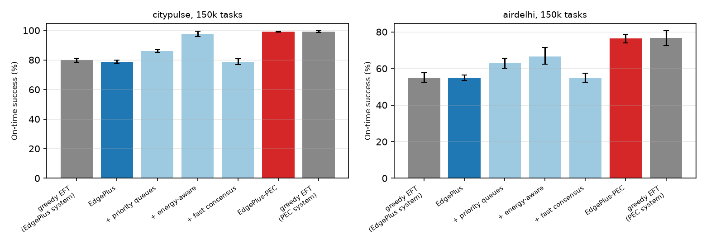
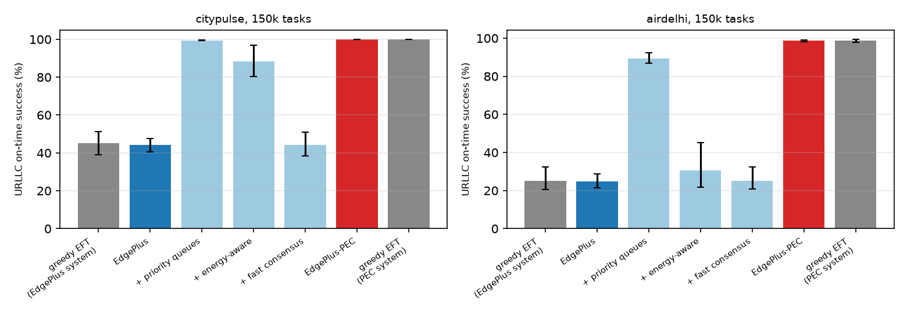
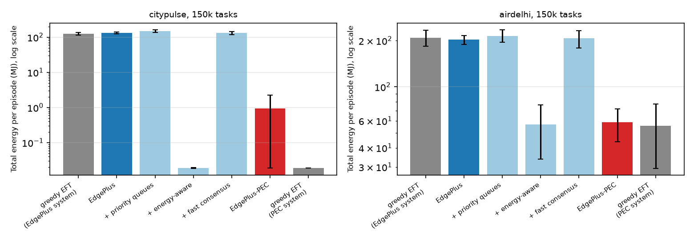

# EdgePlus-PEC: Priority Queues, Energy-Aware Mobility, and Fast Ledger Consensus for Deadline-Aware 6G Edge Scheduling

**Draft of 4 November 2026.** Authors and affiliations to be added.

> Every number in this draft comes from files in the repository (`results/summary/`) or on the `runs-mirror` branch, produced by the scripts named in the text. Section 11 lists the commands that regenerate them.

## Abstract

EdgePlus assigns deadline-constrained air-quality IoT tasks to stationary edge servers, mobile edge servers, and the cloud. It uses masked cooperative PPO (CCPPO), an advisory layer, a particle-swarm outer loop, and a lightweight ledger whose reputation and debt signals feed back into the scheduler. We reimplement EdgePlus in an open, event-driven simulator and extend it with three system-level changes that leave the scheduler untouched:

- **P:** slice-priority queues at servers.
- **E:** energy-aware execution and mobility. A neighbouring site's mobile server serves a task where it is parked instead of driving over, redeployment is damped, and edge cores use slack-based frequency scaling.
- **C:** faster ledger consensus, through time-bounded partial blocks and shorter cloud BFT rounds.

We call the result EdgePlus-PEC. Both systems are trained with the same CCPPO protocol (1.5 million decisions, three seeds) on CityPulse training days. They are evaluated frozen on held-out test days, and, without retraining, on real bus-mounted sensor data from New Delhi (AirDelhi).

At 150,000 tasks per 10-minute episode, EdgePlus-PEC raises on-time success from 78.8% to 99.3% on CityPulse (+20.5 percentage points, 95% CI 19.2–21.7) and from 54.9% to 76.3% on AirDelhi (+21.4 pp). URLLC success rises from 44.1% to 100% and from 24.9% to 98.6%. Energy per episode falls from 133.0 MJ to 0.94 MJ and from 202.7 MJ to 58.7 MJ, almost entirely because mobile servers drive less. Ledger records are committed within 0.50 s (95th percentile) instead of 19–24 s.

The changes have costs. mMTC success falls by 2.3 pp on CityPulse and 12.5 pp on AirDelhi, 95th-percentile latency doubles on AirDelhi (152 s to 308 s), and the ledger uses about ten times more CPU time. A greedy earliest-finish-time rule reaches the same success as the trained scheduler on both systems, so the gains come from the system design rather than from learning. Our EdgePlus reproduction reaches 78.8% at 150k tasks against the 82.77% reported, and EdgePlus's PSO acceptance gate rejected all 18 rounds we ran.

## 1 Introduction

Smart-city air-quality networks produce bursty streams of sensor readings that must be processed before deadlines that depend on urgency. EdgePlus [1] turns such readings into tasks in three 6G slices: URLLC with deadlines of 5–15 s, eMBB with 30–120 s, and mMTC with 120–600 s. It assigns each task to a stationary edge server, a mobile edge server, or the cloud.

Its scheduler is masked cooperative PPO, with one actor per cluster and a centralized critic. Feasibility masks remove servers that would break the routing order, a slice budget, a resource limit, or the deadline. An advisory layer (Nash sharing, PID, leader election) biases the remaining choices, and a constricted particle swarm (PSO) tunes the advisory gains. A two-tier ledger (edge Proof of Authority, cloud BFT) produces reputation and debt signals that enter the state, the reward, and the URLLC mask. EdgePlus reports 82.77% on-time success at its heaviest load of 150,000 tasks.

Three properties of the EdgePlus system, rather than of its learner, limit what any scheduler can achieve on it:

1. **First-come, first-served servers.** A URLLC task with a 5-second deadline can wait behind mMTC work that has minutes of slack.
2. **Mobile servers must drive.** A mobile server in a neighbouring cluster can serve a task only after driving to the task's location (EdgePlus Eq. 1, term L_move). At city scale this takes minutes, too long for most deadlines. When movement is counted in energy, as in EdgePlus Eq. 2, the driving energy dwarfs the computing energy.
3. **Late reputation updates.** Reputation and debt change only when a ledger block commits (EdgePlus Sec. III-M.7), and a block commits only when it is full (Eq. 21). EdgePlus reports per-block validation costs (0.39 ms at the edge) but not how long a record waits before it is committed.

This paper makes four contributions:

1. **An open reproduction of EdgePlus.** It includes an event-driven simulator whose queueing engine matches Erlang C, Pollaczek–Khinchine, and Cobham's priority formula within 5%, and CCPPO with the advisory layer, PSO, and ledger feedback. It also includes a timed model of the ledger, built from cryptographic costs measured on our hardware.
2. **EdgePlus-PEC.** It changes the system in the three ways listed in the abstract (P, E, C) and keeps EdgePlus's scheduler, so each change can be evaluated alone.
3. **A controlled comparison.** Both systems use the same learner, training budget, episodes, and random draws. We train three seeds per system, use paired tests on held-out days, and transfer to a second, real dataset (AirDelhi) without retraining.
4. **Results reported as measured,** including those that favour neither our design nor EdgePlus's claims:
   - the trained scheduler does no better than a greedy rule;
   - the PSO gate never accepts a candidate;
   - locality stops tracking success once neighbouring servers can be reached without driving;
   - faster consensus does not change quality of service when there are no adversaries.

Section 2 summarizes EdgePlus and related work. Section 3 describes the shared system model, Section 4 the EdgePlus reproduction, and Section 5 the three extensions. Section 6 gives the experimental setup, Section 7 the results, Section 8 a discussion, and Section 9 the limitations.

## 2 Background and related work

### 2.1 EdgePlus

The parts of EdgePlus [1] that matter here:

- **Routing order** (Sec. III-C). The stationary server in the task's cluster comes first, then mobiles in that cluster, then mobiles in neighbouring clusters, then the cloud. The mask also removes servers that would exceed a per-slice radio or compute budget, capacity, battery, or the deadline. It removes servers with low reputation for URLLC tasks.
- **Masked CCPPO** (Eqs. 8, 10). Clipped PPO with a centralized critic. Actions are sampled only from the masked set.
- **Advisory layer** (Eqs. 9, 11). A logit bias λ_N log s_c + λ_P u_c + λ_L 1[leader] from Nash sharing, a PID controller on cluster utilization, and leader election.
- **PSO outer loop** (Eqs. 12–13). A constricted swarm over outer parameters. A candidate is adopted only if success improves and three conditions hold: cloud share ≤ 0.07, failure rate ≤ 0.05, and stationary share ≥ 0.80.
- **Ledger** (Sec. III-M):
  - **Blocks.** One tuple is logged per completed task (Eq. 18). Each cluster batches its tuples into partial blocks chained by BLAKE2b(SHA3-256(·)) (Eqs. 19–20). Block size adapts to utilization and write rate (Eq. 21).
  - **Consensus.** Blocks are validated by Proof of Authority (PoA) among the cluster's authorities (Eq. 22), then finalized periodically by cloud BFT with Ed25519 signatures (Eqs. 23–25).
  - **Feedback.** Reputation ρ_rep = EMA(1[on time] − κ·1[violation]) and cluster debt d_c = max(0, Θ̄ − Θ_c) (Eqs. 14, 28) enter the state, the reward (Eq. 15), and the URLLC mask.
- **Reported results at 150k tasks** (full system, A1): 82.77% success, Lp50 53.23 s, Lp95 147.09 s, throughput 206.93 tasks/s, cloud share 6.1%. The ablations attribute the largest losses to removing the masks (A5: 77.3%; A6, plain CCPPO: 72.8%).

Our review of EdgePlus (repository file `docs/EdgePlus_Deep_Review.md`) lists the parameters the paper leaves open, and several inconsistencies. Among them, the PID term as written pushes work toward overloaded clusters. We use the corrected sign.

### 2.2 Related work

- **Priority queueing.** Non-preemptive priority classes are the textbook way to serve mixed-criticality traffic [9, 10]. EdgePlus's queue surrogate (Eq. 31, a Kingman-type formula [21, 22]) assumes a single first-come, first-served class.
- **Frequency scaling.** Dynamic voltage and frequency scaling with slack reclamation [11, 12] lowers clock speed when a deadline leaves room. Dynamic energy per cycle grows roughly with the square of frequency.
- **Byzantine agreement.** PBFT [13] needs three message phases and a quorum of 2f + 1 of 3f + 1 replicas. On a LAN its latency is dominated by batching and message delays, not by cryptography.
- **RL with demonstrations.** Anchoring a policy to an expert through an imitation term is a standard way to make RL training reliable [7, 8]. We use such an anchor, identically, for every trained scheduler (Section 4.2).
- **Multi-agent PPO.** Centralized-critic PPO is a strong baseline for cooperative multi-agent problems [6], which is the family CCPPO belongs to.

## 3 System model (shared by both systems)

Both systems run in the same simulator (`src/edgesim/sim/env.py`; specification in `docs/Simulator.md`). Every switch that distinguishes them is a configuration option (`configs/sim.yaml`, `configs/systems.yaml`).

### 3.1 Map, servers, and tasks

- **Sites.** The city is divided into C = 10 sites by weighted K-means over sensor locations. Neighbouring sites come from a Delaunay triangulation of the site centres (mean degree 4.4).
- **Servers.** Each site has one stationary server, with cores proportional to the site's demand, and two mobile servers. There are two cloud servers, so 32 servers in total. Servers are multi-core and run one task per core.
- **Capacity.** A single factor (0.38) scales every core speed. It was calibrated on CityPulse validation days so that rule-based dispatchers land in the regime EdgePlus reports at 150k tasks.
- **Tasks.** Tasks are built from sensor readings following EdgePlus's labelling procedure (Alg. 3). Slice shares are fixed at 20/50/30% (URLLC/eMBB/mMTC) and deadlines are drawn uniformly from EdgePlus's bands. An episode spans 600 s of arrivals at one of three loads: 50,000, 100,000, or 150,000 tasks.

### 3.2 Latency, queues, and energy

- **Latency** follows EdgePlus Eq. 1: uplink time (a Shannon-type rate per slice, Eq. 30), movement time for mobiles, queueing, and processing.
- **Queues are simulated explicitly**, with random service times (lognormal factor, σ = 0.25) and random uplink and driving times. A formula serves only as the mask's predictor.
- **Validation.** The queueing engine was checked against Erlang C, Pollaczek–Khinchine, and Cobham's non-preemptive priority formula [9, 10]. Every case is within 5% (`results/summary/sim_validation.json`).
- **Energy** follows EdgePlus Eq. 2, with four parts:
  - device transmission at 0.2 W over the uplink time;
  - computing at 2, 3, and 1 × 10⁻¹¹ J per cycle on stationary, mobile, and cloud servers;
  - network transfer at 2 × 10⁻⁸ J per bit;
  - vehicle driving at 540 J per metre (about 0.15 kWh/km).

### 3.3 Feasibility mask

The mask applies five checks:

- EdgePlus's routing order;
- per-slice compute and radio budgets, implemented as token buckets refilled over 10 s windows (shares of 15/75/10% for compute and 25/55/20% for radio);
- memory, and battery for mobiles;
- the deadline, checked with a predictor based on the current backlog;
- quarantine of servers with reputation below 0.7, for URLLC tasks only.

If no server passes every check, the task goes to the server with the lowest predicted latency, preferring servers still predicted to meet the deadline (best effort). If no server is physically available (memory full, or battery below reserve), the task is dropped.

### 3.4 Mobility

We use EdgePlus's redeployment rule, with straight-line routes (road factor 1.3, up to 120 km/h) instead of CBS–D* Lite:

- Every 5 s, a site with more than 10 s of queued work per core pulls the least-loaded mobile from its calmest neighbour, provided that neighbour has less than 2 s of queued work.
- At most two moves happen per step.
- Assigning a task to a neighbouring site's mobile also drives that mobile to the task's site. This is EdgePlus's L_move.

### 3.5 A timed model of the EdgePlus ledger

EdgePlus specifies what the ledger records and how blocks are validated, but not when reputation and debt actually change. We model the timing explicitly; Table 1 lists the parameters.

- **Writes.** Each completed task writes a tuple to its home cluster's pending block.
- **Block cutting.** A block is cut when it holds S_c(t) tuples. S_c(t) follows Eq. 21 and is recomputed every 5 s from cluster utilization and write rate, capped at S_max.
- **Edge PoA.** The leader hashes the block (SHA3-256, then BLAKE2b), checks the AES-GCM tags, and signs the block with Ed25519. Each of the 10 authorities verifies the signature, re-checks the tags, re-hashes, and signs a vote. The leader then verifies a two-thirds quorum of votes (7). The two network hops cost 0.5 ms each. One cluster's blocks are validated one after another.
- **Validation cost.** A block of 16–256 tuples takes 1.8–2.1 ms to validate, 1.0 ms of which is network delay. The computation alone (0.8–1.1 ms) is above EdgePlus's reported 0.39 ms median, mainly because we verify 7 vote signatures. Either way, validation takes milliseconds, while filling a block takes seconds.
- **Cloud BFT.** PBFT [13] with 4 replicas (tolerating one fault) finalizes the cluster hashes every 5 s, which is our reading of EdgePlus's "periodically". One round costs 2.2 ms: three one-way delays of 0.5 ms plus signatures. EdgePlus reports 6.9 ms (tables) and 2.30 ms (Fig. 19).
- **Feedback timing.** Following EdgePlus Sec. III-M.7, a server's reputation and its cluster's debt change when the tuple's block is committed at the edge. A record is final when its cluster hash is included in a completed BFT round.

Making the ledger timed changes little for EdgePlus itself. On one CityPulse validation episode at 150k, greedy EFT's success moved from 77.88% (reputation updated instantly at completion) to 77.77% (updated at block commit). On the test days, the rule-based result for EdgePlus's system is 79.9% with the timed ledger. Our earlier simulator milestone (M2, `results/summary/heuristics_citypulse_test.json`) reported 80.6% with instant updates.

**Table 1. Ledger timing parameters.** Values marked * are not given by EdgePlus. Cryptographic costs were measured on our machine with `scripts/bench_crypto.py` (`results/summary/crypto_bench.json`).

| Parameter | Value |
|---|---|
| Block size bounds S_min, S_max (Eq. 21)* | 16, 256 tuples |
| ρ_max, λ_max (Eq. 21)* | 1.0, 50 tuples/s per cluster |
| PoA authorities per cluster; votes collected* | 10; 7 (two thirds) |
| Cloud BFT replicas*; round period* | 4; 5 s (EdgePlus), 0.5 s (EdgePlus-PEC) |
| Block time bound* | none (EdgePlus), 0.5 s (EdgePlus-PEC) |
| Ed25519 sign / verify | 27.3 µs / 89.8 µs |
| AES-GCM tag check (96-byte tuple) | 0.45 µs |
| Block hash, SHA3-256 then BLAKE2b | 1.11 µs + 0.178 µs per tuple |
| LAN hop at a site; one-way delay between cloud replicas | 0.5 ms; 0.5 ms |

## 4 Reproducing EdgePlus

### 4.1 Learner

- **Actors.** There is one actor per site: a two-layer MLP with 128 tanh units, implemented as stacked weights. Its input is the task's features (slice, priority, slack, cycles, payload, memory, episode time) plus one row per server (32 rows). Each row holds (`src/edgesim/agents/features.py`):
  - whether the mask allows the server, and its routing tier;
  - predicted latency relative to the task's slack, the predicted queue wait, processing time, and driving time;
  - utilization, memory in use, reputation, server kind, and the debt of the server's site;
  - a flag for the fastest feasible server and the server's latency rank among feasible servers.
- **Action selection.** The actor outputs logits over all 32 servers. The advisory biases are added, the mask is applied, and a softmax gives the policy.
- **Critic.** A centralized critic sees the local observation plus global site features.
- **PPO.** Generalized advantage estimation [5] (λ = 0.95), clipping 0.2, 4 epochs, minibatches of 1,024, and gradient clipping at 0.5.
- **Delayed rewards.** A decision's reward is known only when its task finishes. Each environment keeps a ring buffer of decisions, and a step is used once its reward is known. GAE is truncated at the first successor whose reward is still unknown. Samples from older policies get a truncated importance weight.
- **Reward** (EdgePlus Eqs. 7 and 15). Each finished task contributes these terms:
  - +w_p if on time, −w_p if late, with w = 3/2/1 for URLLC/eMBB/mMTC;
  - −0.5·min(L/D, 3), where L is latency and D the deadline;
  - −0.05·min(E/0.1 J, 5), where E is the task's energy, including any driving its assignment caused (EdgePlus Eq. 2);
  - −0.2 if the task ran in the cloud;
  - −0.5·max(0, 0.6 − ρ_rep) − 0.01·d_c, the ledger shaping of Eq. 15;
  - the total is scaled by 0.1.
- **Advisory layer.** The Nash term has no interaction between players, so it reduces to a closed-form load discount. The PID term uses the corrected sign (bias −λ_P·u_c). The leader term adds a bonus to the best-scored server of each site. Default gains: λ_N = 0.3, λ_P = 0.3, λ_L = 0.2, ρ_set = 0.7.
- **PSO** searches over (λ_N, λ_P, λ_L, ρ_set):
  - constricted swarm with c1 = c2 = 2.05 (constriction factor 0.7298) and inertia falling from 0.9 to 0.4;
  - 4 particles and 2 iterations per round;
  - each particle is scored by running the frozen policy on one 200 s stress episode from a training day;
  - two rounds per run, at 50% and 85% of the training budget, accepted only through EdgePlus's gate.

### 4.2 Training protocol

Every trained run, for both systems, uses the same protocol:

- **Budget:** 1.5 million decisions.
- **Episodes:** 600 s episodes from training days, with loads of 50k, 100k, and 150k sampled 1 : 1 : 2.
- **Settings:** eight parallel environments; learning rate 3 × 10⁻⁴, decaying linearly to 30% of its start value; discount 0.9; 1,024 steps per environment per update; entropy weight 0.003.

We add one element that EdgePlus does not describe: a warm start, applied identically to every run. For the first 300,000 decisions, the environments follow greedy earliest-finish-time (EFT), which picks the feasible server with the lowest predicted completion time, and the actor imitates it. After that, PPO trains with an added imitation term of constant weight 0.3.

We adopted the warm start after tuning on CityPulse validation days. Without it, PPO reached only 61–66% success at 150k after 0.85–1.15 million decisions, against 80% for greedy EFT on the same episodes. A diagnostic episode showed why: the policy chose the fastest feasible server only 6% of the time and sent 55% of its decisions to the cloud.

With a warm start, the weight of the imitation term decides whether PPO fine-tuning keeps or loses the expert's level (Table 2). Every schedule that lets the weight reach zero falls back to 69–72%, even when it reaches zero only at the end of training. Any weight that stays positive holds 79%. We chose a constant 0.3.

As a result, the trained schedulers agree with greedy EFT on 99.2–99.99% of decisions in the last ten updates of training. Agreement is measured on a sample of each update's decisions (`agree` in each run's `log.jsonl`). Section 7.6 returns to this.

The runs in Tables 2 and 5 predate two later changes to the simulator and reward. They used instant ledger updates instead of the timed ledger (Section 3.5), and their reward did not count driving energy. Their numbers are comparable with each other, not with Tables 6–9.

**Table 2. Imitation-weight pilot** (CityPulse validation days, 2 episodes at 150k, one seed, advisory layer on, PSO off, 1.5M decisions; `runs/citypulse/<run>/eval_citypulse_val.csv`).

| Imitation weight after the 300k-decision warm start | Success at 150k | URLLC |
|---|---|---|
| fades from 1 to 0 by mid-training | 69.1% | 26.3% |
| fades from 1 to 0 by the end of training | 72.3% | 34.3% |
| fades from 1 to 0.5 | 78.9% | 45.2% |
| constant 0.3 (adopted) | 79.3% | 46.0% |
| constant 1.0 | 78.8% | 44.4% |
| greedy EFT (rule, same episodes) | 80.1% | 46.5% |

## 5 EdgePlus-PEC

Each change below is a configuration switch. The scheduler, masks, advisory layer, PSO, reward, features, and training protocol are identical in EdgePlus and EdgePlus-PEC. Table 3 shows which switches each evaluated system uses.

### 5.1 P: slice-priority queues

- **Service order.** Every server runs URLLC before eMBB before mMTC, first come, first served within a slice, without preemption.
- **Mask predictor.** The waiting-time predictor counts only work of equal or higher priority queued ahead. It divides that work by 1 − ρ_high, where ρ_high is the recent offered load of higher slices on the server, to account for higher-priority tasks that arrive while the task waits.
- **Unchanged.** Admission, routing order, and slice budgets are the same as in EdgePlus.

### 5.2 E: energy-aware execution and mobility

- **Serve in place.** A mobile server parked in a neighbouring site serves the task where it is. The task's data travels from the home site to the neighbour over a metro link: 1 Gbps, shared first-come first-served per home site, 2 ms one way, plus 2 ms for the result to come back. The transfer is charged network energy (2 × 10⁻⁸ J per bit). In EdgePlus, the same assignment makes the vehicle drive to the task's site. That takes minutes at city scale and costs 540 J per metre.
- **Damped redeployment.** The distress rule moves a mobile only after a site has been distressed for two consecutive 5 s steps. It takes the mobile from the nearest calm neighbour rather than the calmest one.
- **Slack-based DVFS.** When an edge core starts a task, it picks the lowest speed in {0.6, 0.8, 1.0} at which the slowed run time, plus a 50% safety margin, still fits before the deadline. It does so only when the server has no queued task and keeps another core free, so no other task waits longer. Dynamic energy per cycle scales with the square of the speed [11, 12].

### 5.3 C: fast ledger consensus

- **Time-bounded blocks.** A partial block is cut when it reaches S_c(t) tuples (Eq. 21), or 0.5 s after its first tuple, whichever comes first.
- **Short BFT rounds.** Cloud finalization runs every 0.5 s instead of every 5 s.
- **Unchanged.** Hashing, the PoA quorum, signatures, and the reputation and debt rules are the same as in EdgePlus.
- **Cost.** There are more, smaller blocks. A CityPulse test episode at 150k produces 11,108 blocks and 1,255 BFT rounds under EdgePlus-PEC, against 643 and 146 under EdgePlus.

**Table 3. Evaluated systems** (`configs/systems.yaml`). Every system runs the same full EdgePlus scheduler (`configs/methods.yaml`).

| System | Queues | Neighbouring mobiles | Redeployment | DVFS | Ledger blocks and BFT |
|---|---|---|---|---|---|
| EdgePlus | FIFO | drive to the task | EdgePlus rule | off | full blocks only; BFT every 5 s |
| + P | slice priority | drive | EdgePlus rule | off | as EdgePlus |
| + E | FIFO | serve in place | damped | on | as EdgePlus |
| + C | FIFO | drive | EdgePlus rule | off | ≤ 0.5 s per block; BFT every 0.5 s |
| EdgePlus-PEC | slice priority | serve in place | damped | on | ≤ 0.5 s per block; BFT every 0.5 s |

## 6 Experimental setup

**Datasets.**

| Dataset | Content |
|---|---|
| CityPulse pollution [3] | 449 sites, 1 August to 1 October 2014, readings every 5 minutes, 7.9 million rows. Generated data located in Aarhus. The site count and period match those EdgePlus reports for its traces. |
| AirDelhi [2] | Particulate-matter sensors on 13 public buses in New Delhi, 1 November 2020 to 30 January 2021, a reading about every 3 s, 12.5 million real readings. |

Both datasets are split by day into training, validation, and test days (`configs/datasets/*.yaml`). Both maps are built with the same procedure, so they have the same server structure (10 stationary, 20 mobile, 2 cloud). This lets a scheduler trained on one map run on the other unchanged.

**Training.** All schedulers are trained on CityPulse training days only.

- **Runs.** Two systems with three training seeds each: EdgePlus (the full system A1, with masks, advisory, PSO with the paper's gate, and ledger feedback) and EdgePlus-PEC. Each single-change system (+P, +E, +C) has one seed. That is nine runs of 1.5 million decisions each.
- **Compute.** Each run took about 45 minutes, with all nine running in parallel on a 4-core (8-thread) Xeon CPU without a GPU.
- **Protocol choices.** The imitation weight and the EdgePlus-PEC parameters were set on CityPulse validation days. The PEC parameters were set by hand after one validation episode with greedy EFT, without a search. An earlier version of E that only discouraged drives to neighbouring sites saved 2% of driving energy on that episode (131.7 MJ to 129.1 MJ), so we replaced it with serve-in-place.

**Evaluation.**

- **Policies.** Each trained policy is frozen and acts greedily (the most likely feasible server), with PSO off.
- **Episodes.** Each run is evaluated on five test episodes at 150k tasks (test seeds 0–4). A seed selects a window of test days and fixes every random service, uplink, and driving draw, so all systems face identical tasks and randomness.
- **Transfer.** The same trained policies are evaluated on AirDelhi test days, without retraining.
- **Reference.** Greedy EFT is run on both systems on the same episodes.
- **100k tasks.** Greedy EFT was also run at this load. The trained policies were evaluated at 150k only.

**Statistics.**

- **Confidence intervals.** Means come with bootstrap 95% confidence intervals [20] (5,000 resamples over episodes).
- **Pairing.** EdgePlus-PEC is compared with EdgePlus over 15 pairs (training seed × test seed).
- **Tests.** Two-sided Wilcoxon signed-rank tests [18], with Benjamini–Hochberg correction [19] across the 12 primary tests (6 metrics × 2 datasets). The rank-biserial correlation r gives the effect size. With 15 pairs, the smallest possible two-sided p-value is 6.1 × 10⁻⁵; it occurs when all pairs differ in the same direction.

**Metrics.**

- success: share of tasks finished before their deadline, overall and per slice;
- latency: median and 95th percentile (Lp50, Lp95) over executed tasks;
- throughput: on-time completions per second;
- cloud share, and locality (share of executed tasks run in their home site);
- energy per episode: device transmission, computing, network, and vehicle driving;
- ledger commit delay (from a tuple's write to its PoA commit), finality delay (to inclusion in a completed BFT round), and ledger CPU time.

## 7 Results

Tables 4–9 and Figures 1–3 summarize the results. The full output, with bootstrap intervals for every metric, is in `results/summary/pec_comparison.md` and `.json`, generated by `scripts/compare.py`.

### 7.1 How close the reproduction is

**Table 4. EdgePlus at 150k tasks: reported values against our reproduction** (CityPulse test days; 3 training seeds × 5 episodes; bootstrap 95% CI in brackets).

| Metric | EdgePlus paper, A1 [1] | Our reproduction |
|---|---|---|
| On-time success | 82.77% | 78.8% [77.7, 79.8] |
| Violations | 17.23% | 21.2% |
| Lp50 | 53.23 s | 15.9 s |
| Lp95 | 147.09 s | 117.0 s |
| Throughput | 206.93 tasks/s | 196.9 tasks/s |
| Cloud share | 6.1% | 14.4% |

- **Success at 150k.** Our EdgePlus is 4.0 pp below the reported value.
- **Latency and cloud share.** Median latency is much lower than reported and cloud use is more than twice as high. EdgePlus does not give enough detail about its network and capacity to locate the difference.
- **Shape across loads.** EdgePlus reports about 17.5% violations at 100k and 17.2% at 150k. In our simulator, greedy EFT misses no task at 100k on either system (Table 6 notes) and 20% at 150k. We calibrated capacity at 150k only, so the curve between loads is not reproduced.
- **Learner against rule.** The trained EdgePlus scheduler reaches the same success as greedy EFT on its system: 78.8% against 79.9% [78.5, 81.3].
- **PSO.** EdgePlus's gate rejected all 18 rounds (2 rounds × 9 runs, `pso.jsonl` in each run). The best candidates had failure rates of 0–8.7%. Their cloud shares (8.8–15.2%) all exceeded the gate's 7% limit, and their stationary shares (0.27–0.45) were far below the required 0.80.

**Earlier-protocol ablations.** Before adopting the constant imitation weight, we trained EdgePlus's ablations once (seed 0) with the imitation term fading to zero. Table 5 reports them as a sensitivity result, from 2 validation episodes each.

- **All variants fall below the rule.** Every trained variant ends 7.6–15.7 pp below greedy EFT.
- **The ordering differs from EdgePlus's.** EdgePlus reports A1 82.8% > A4 ≈ A2 > A3 80.0% > A5 77.3% > A6 72.8%. Here, removing everything (A6) or only the advisory layer (A3) gave the best results.
- **Only one effect agrees.** Removing only the masks (A5) gave the worst result in both studies.
- **A gate that does accept candidates.** A relative PSO gate (accept if success rises without raising cloud share) accepted both its rounds. It still left validation success unchanged within noise: 68.7% against 67.9% for A1.

We draw no further conclusions from this table.

**Table 5. Ablations under the earlier protocol** (imitation fading to 0; seed 0; CityPulse validation days, 2 episodes at 150k).

| Variant | Success | Variant | Success |
|---|---|---|---|
| A1 full EdgePlus | 67.9% | A5 no masks | 64.4% |
| A2 no PSO | 69.1% | A6 plain CCPPO | 72.5% |
| A3 no advisory | 72.4% | CCPPO with Lagrangian penalty | 68.9% |
| A4 no ledger feedback | 70.4% | ensemble PPO | 71.0% |
| greedy EFT (rule) | 80.1% | A1 with relative PSO gate | 68.7% |

### 7.2 EdgePlus-PEC against EdgePlus on CityPulse

**Table 6. CityPulse test days, 150k tasks.** Means over episodes; success with bootstrap 95% CI. Trained policies: 3 seeds × 5 episodes for EdgePlus and EdgePlus-PEC, 1 seed × 5 episodes for the single-change systems. Greedy EFT: 5 episodes.

| System | Success % | URLLC % | eMBB % | mMTC % | Lp50 (s) | Lp95 (s) | Throughput (/s) | Cloud % | Locality % | Energy | Commit p95 (s) | Finality p95 (s) |
|---|---|---|---|---|---|---|---|---|---|---|---|---|
| EdgePlus | 78.8 [77.7, 79.8] | 44.1 | 79.9 | 99.9 | 15.9 | 117.0 | 196.9 | 14.4 | 85.6 | 133.0 MJ | 19.3 | 22.0 |
| + P | 86.0 [85.2, 86.8] | 99.5 | 75.8 | 94.0 | 14.0 | 182.6 | 215.0 | 19.7 | 80.3 | 148.9 MJ | 20.5 | 23.3 |
| + E | 97.6 [95.8, 99.4] | 88.4 | 99.8 | 100.0 | 4.4 | 25.2 | 243.9 | 9.2 | 38.4 | 0.019 MJ | 15.3 | 18.2 |
| + C | 78.8 [76.9, 80.7] | 44.3 | 80.0 | 99.95 | 15.7 | 115.2 | 197.1 | 14.3 | 85.6 | 132.3 MJ | 0.50 | 0.93 |
| **EdgePlus-PEC** | **99.3 [98.9, 99.6]** | **100.0** | **99.96** | 97.6 | **3.1** | 127.6 | **248.2** | 10.9 | 39.7 | 0.94 MJ | **0.50** | **0.92** |
| greedy EFT, EdgePlus system | 79.9 [78.5, 81.3] | 45.2 | 81.8 | 99.97 | 15.6 | 108.6 | 199.8 | 14.1 | 85.8 | 126.5 MJ | 19.2 | 21.9 |
| greedy EFT, PEC system | 99.2 [98.6, 99.8] | 100.0 | 99.9 | 97.4 | 3.1 | 123.7 | 248.0 | 12.2 | 41.1 | 0.019 MJ | 0.50 | 0.92 |

*At 100k tasks*, greedy EFT met every deadline on both systems, with Lp95 of 4.1 s (EdgePlus) and 5.8 s (EdgePlus-PEC).

EdgePlus-PEC was better than EdgePlus in every one of the 15 paired episodes (Table 8):

- **Success:** 78.8% to 99.3% (+20.5 pp, 95% CI 19.2–21.7, q = 6.7 × 10⁻⁵, r = +1.00).
- **By slice:** URLLC 44.1% to 100% and eMBB 79.9% to 99.96%. mMTC fell from 99.9% to 97.6%.
- **Throughput and median latency:** 196.9 to 248.2 on-time completions per second; median latency 15.9 s to 3.1 s.
- **Tail latency:** Lp95 rose from 117.0 s to 127.6 s, but the paired difference is not significant (+10.7 s, 95% CI −19.1 to +39.4, p = 0.36).
- **Dropped tasks:** 1.5% of tasks found no physically available server under EdgePlus; none did under EdgePlus-PEC.

Energy per episode fell from 133.0 MJ to 0.94 MJ (Figure 3), and the composition matters:

- **Driving** fell from 246 km to 1.7 km per episode.
- **Computing and network energy** rose by 67%, from 11.4 kJ to 19.0 kJ, because data now travels to neighbouring sites. Counting computing and network energy alone, EdgePlus-PEC uses more energy than EdgePlus.
- **Locality** fell from 85.6% to 39.7% and cloud share from 14.4% to 10.9%, because neighbouring mobiles now do much of the work.

The ledger change worked as intended: the 95th-percentile commit delay fell from 19.3 s to 0.50 s and finality from 22.0 s to 0.92 s.



**Figure 1.** On-time success at 150k tasks (CityPulse and AirDelhi test days; bootstrap 95% CIs). Grey bars: greedy EFT on each system. Dark blue: EdgePlus. Light blue: one change at a time. Red: EdgePlus-PEC.



**Figure 2.** URLLC on-time success at 150k tasks.



**Figure 3.** Total energy per 600 s episode at 150k tasks, on a log scale: device transmission, computing, network, and vehicle driving. EdgePlus-PEC's wide interval on CityPulse comes from a few episodes in which a mobile was still redeployed.

### 7.3 What each change contributes

The single-change systems (one seed each, Table 6) separate the effects:

- **P alone** raises success to 86.0% (+7.3 pp) and URLLC to 99.5%. It shifts the misses onto the other slices: eMBB falls from 79.9% to 75.8% and mMTC from 99.9% to 94.0%, Lp95 rises to 182.6 s, and driving energy rises to 148.9 MJ.
- **E alone** raises success to 97.6% and URLLC to 88.4%. It lowers Lp95 to 25.2 s and removes all driving, leaving 19.2 kJ of total energy. Most of this comes from serve-in-place, which makes a neighbouring site's mobile usable within milliseconds instead of minutes. DVFS slowed only 3.4% of tasks (3.1% in EdgePlus-PEC). A slowed task saves 36–64% of its computing energy, so DVFS saves roughly 1–2% of computing energy overall. We did not run it in isolation.
- **C alone** leaves success unchanged (78.8%). It cuts the commit delay to 0.50 s and finality to 0.93 s, and raises ledger CPU time from 2.6 s to 28.5 s per episode.
- **The combination.** Adding P on top of E lifts URLLC from 88.4% to 100% and overall success from 97.6% to 99.3%. The cost is mMTC (100% to 97.6%) and the tail: Lp95 goes from 25.2 s to 127.6 s.

### 7.4 Transfer to New Delhi without retraining

**Table 7. AirDelhi test days, 150k tasks, policies trained on CityPulse.** Layout as in Table 6.

| System | Success % | URLLC % | eMBB % | mMTC % | Lp50 (s) | Lp95 (s) | Throughput (/s) | Cloud % | Locality % | Energy | Commit p95 (s) | Finality p95 (s) |
|---|---|---|---|---|---|---|---|---|---|---|---|---|
| EdgePlus | 54.9 [53.6, 56.3] | 24.9 | 40.5 | 98.8 | 40.0 | 152.2 | 137.3 | 37.2 | 62.8 | 202.7 MJ | 23.6 | 26.2 |
| + P | 63.0 [60.1, 65.5] | 89.2 | 39.7 | 84.2 | 30.1 | 332.7 | 157.4 | 34.0 | 66.0 | 214.7 MJ | 26.0 | 28.7 |
| + E | 66.4 [62.4, 71.4] | 30.6 | 60.7 | 99.9 | 36.2 | 141.8 | 166.1 | 27.8 | 45.5 | 56.6 MJ | 17.6 | 20.4 |
| + C | 54.8 [52.5, 57.3] | 25.0 | 40.4 | 98.8 | 40.1 | 152.6 | 137.1 | 37.1 | 62.8 | 206.9 MJ | 0.50 | 0.93 |
| **EdgePlus-PEC** | **76.3 [74.0, 78.7]** | **98.6** | **61.4** | 86.4 | **23.9** | 307.8 | **190.8** | 27.8 | 46.4 | 58.7 MJ | **0.50** | **0.92** |
| greedy EFT, EdgePlus system | 54.9 [52.6, 57.6] | 25.0 | 40.5 | 98.8 | 40.0 | 152.2 | 137.3 | 37.2 | 62.8 | 208.8 MJ | 23.6 | 26.2 |
| greedy EFT, PEC system | 76.6 [72.5, 80.7] | 98.6 | 62.0 | 86.4 | 23.4 | 307.8 | 191.6 | 28.0 | 46.0 | 55.8 MJ | 0.50 | 0.92 |

The real Delhi workload is harder for both systems: EdgePlus reaches 54.9% instead of 78.8%. EdgePlus-PEC keeps a margin of the same size (+21.4 pp, 95% CI 19.7–22.9) and raises URLLC success from 24.9% to 98.6%. On Delhi, however, its costs are larger:

- **mMTC** success falls from 98.8% to 86.4%.
- **Tail latency** doubles: Lp95 goes from 152.2 s to 307.8 s, a significant increase of 156 s (95% CI 102–217).

Some other effects also differ from CityPulse:

- **Energy** falls by 144 MJ per episode (202.7 to 58.7 MJ), less than on CityPulse. The damped distress rule still drives mobiles on this burstier data (109 km and 8.9 moves per episode, against 375 km and 48.3 moves under EdgePlus).
- **Dropped tasks** (no physically available server) fall from 18.8% to 10.7%.
- **Fairness:** the Jain index over sites rises from 0.94 to 0.99.
- **Single changes.** Neither P (63.0%) nor E (66.4%) comes close to the combination on Delhi. On CityPulse, E alone nearly matched it.

### 7.5 Paired statistics

**Table 8. EdgePlus-PEC minus EdgePlus, paired over 15 episodes** (3 training seeds × 5 test seeds). Mean difference, bootstrap 95% CI, and Benjamini–Hochberg-adjusted Wilcoxon q. The rank-biserial r is +1.00 or −1.00 (all 15 pairs in one direction) except where shown.

| Metric | CityPulse | AirDelhi |
|---|---|---|
| Success (pp) | +20.5 [+19.2, +21.7], q = 6.7e-5 | +21.4 [+19.7, +22.9], q = 6.7e-5 |
| URLLC success (pp) | +55.9 [+52.3, +59.4], q = 6.7e-5 | +73.7 [+70.0, +76.9], q = 6.7e-5 |
| Lp95 (s) | +10.7 [−19.1, +39.4], q = 0.36, r = +0.28 | +156 [+102, +217], q = 6.7e-5 (worse) |
| Energy per episode (MJ) | −132 [−140, −124], q = 6.7e-5 | −144 [−153, −134], q = 6.7e-5 |
| Ledger commit delay, p95 (s) | −18.8 [−19.0, −18.7], q = 6.7e-5 | −23.1 [−24.2, −21.9], q = 6.7e-5 |
| Ledger finality delay, p95 (s) | −21.1 [−21.2, −21.0], q = 6.7e-5 | −25.3 [−26.4, −24.1], q = 6.7e-5 |

### 7.6 What learning adds

**Table 9. Trained scheduler against greedy EFT on the same system** (success at 150k, test days).

| Dataset | EdgePlus system: CCPPO | EdgePlus system: greedy EFT | PEC system: CCPPO | PEC system: greedy EFT |
|---|---|---|---|---|
| CityPulse | 78.8% | 79.9% | 99.3% | 99.2% |
| AirDelhi | 54.9% | 54.9% | 76.3% | 76.6% |

On both systems and both datasets, the trained scheduler matches greedy EFT within the confidence intervals, as expected from its 99%+ agreement with the rule (Section 4.2). The improvements of EdgePlus-PEC are therefore improvements of the system. Greedy EFT gains as much from them as the trained scheduler does.

The comparison is still fair, because both systems use the identical trained scheduler. It does not show that CCPPO adds value over a simple rule in either system. Without the imitation anchor, CCPPO stayed 8–16 pp below the rule (Tables 2 and 5).

### 7.7 Cost of fast consensus

Faster commits require more blocks and more BFT rounds:

- **Blocks:** 11,108 instead of 643 per CityPulse test episode.
- **BFT rounds:** 1,255 instead of 146.
- **Ledger CPU time:** 24.9 s (EdgePlus-PEC) or 28.5 s (+C) per 600 s episode, instead of 2.6 s, about ten times more.

Even after the increase, the ledger's CPU time is about 0.01–0.02% of the CPU time spent executing tasks. Our model does not include contention between ledger work and task execution.

## 8 Discussion

**System design matters more than the learner in our experiments.** With the imitation anchor, CCPPO reproduces greedy EFT. Without it, CCPPO falls well below the rule. EdgePlus reports its learned methods within 79.4–82.8% at 150k; in our simulator, greedy EFT reaches 79.9% at that load. The three system changes, by contrast, move success by 20 pp or more for every scheduler we ran.

This agrees with EdgePlus's own lesson that feasibility matters most. Here the levers are how servers order their queues and how remote capacity is reached.

**Locality is a proxy, not a goal.** EdgePlus finds that higher locality goes with fewer violations (its OBJ4). Under EdgePlus-PEC, locality halves (85.6% to 39.7%) while violations fall from 21.2% to 0.7%. Neighbouring mobiles can now be reached in milliseconds instead of minutes. The link between locality and success depends on what it costs to reach capacity outside the home site.

**Energy accounting decides the energy result.** Once vehicle movement is counted (EdgePlus Eq. 2), driving is 99.99% of EdgePlus's energy in our model. Counting computing and network energy alone would show EdgePlus-PEC 67% worse. We recommend reporting both parts separately. In our results, DVFS saved little at heavy load, because servers rarely have a spare core and an empty queue at the same time.

**Priority queues move misses to the lowest slice.** Slice priority gives URLLC tasks almost every deadline, at the cost of mMTC and of tail latency. On Delhi, this costs 12.5 pp of mMTC success and doubles Lp95. Ageing, or ordering by deadline within and across slices, could limit the cost; we did not test either.

**Fast consensus improves accountability, not quality of service, in a benign system.** Without faulty or dishonest servers, reputation is a delayed congestion signal. Making it about 40 times fresher (commit p95 from 19.3 s to 0.50 s) does not change success. This matches EdgePlus's own finding that removing ledger feedback (A4) leaves success unchanged. The benefit is that records become final within a second instead of about 22 seconds, at about ten times the ledger CPU time. It would matter with faulty or dishonest servers, which we did not simulate.

## 9 Limitations and threats to validity

- **Simulator.** All results come from a simulator. It is validated against queueing theory, but the network, energy, and capacity parameters are our choices wherever EdgePlus is silent.
- **Serve-in-place assumptions.** Serve-in-place assumes a 1 Gbps metro link from each site to its neighbours. This one assumption carries most of EdgePlus-PEC's gain. With a slower or congested link, the gain would shrink; we did not vary the link.
- **Parameters.** The PEC parameters (0.5 s block bound and BFT period, two-step distress persistence, DVFS levels and margin) were set by hand on validation data without a search. EdgePlus's own hyperparameters received no search either.
- **Statistical scope.** EdgePlus and EdgePlus-PEC have three training seeds; the single-change systems have one. There are five test episodes per run, and trained policies were evaluated only at 150k.
- **Warm start.** The warm start and imitation anchor are not part of EdgePlus. They make the trained schedulers behave like greedy EFT.
- **Not reproduced.** The FD3QN, DDPG, and SAC baselines; the PID robustness study (OBJ6); the security experiments (OBJ7); and CBS–D* Lite routing.
- **Ledger model.** The ledger is an analytic timing model with measured cryptographic costs, not a distributed implementation, and it has no adversaries.
- **Transfer.** The AirDelhi map has the same server structure as the CityPulse map. Only the workload and the geography change.
- **Reproduction gaps.** At 150k, our EdgePlus is 4.0 pp below the reported success. Our load curve is also steeper: at 100k, greedy EFT misses no deadline on EdgePlus's system, where EdgePlus reports about 17.5% violations.

## 10 Conclusion

We reproduced EdgePlus in an open simulator and extended it with three system changes: slice-priority queues, energy-aware execution and mobility, and fast ledger consensus. With the scheduler unchanged and trained identically, EdgePlus-PEC raised on-time success at 150k tasks by about 20 pp on both the CityPulse data EdgePlus used and real data from New Delhi. URLLC tasks met 98.6–100% of their deadlines. Energy fell by 71–99%, mostly through less driving, and ledger records were committed within half a second.

The gains come from the system, not from learning: a greedy rule reaches the same success on both systems. They come with lower mMTC success, longer tails on the Delhi data, and more ledger work. Next steps:

- test serve-in-place with slower and shared links;
- add deadline-aware ordering within slices to protect mMTC;
- simulate faulty or dishonest servers, so the faster ledger has an adversary to catch;
- evaluate the trained policies at every load and with more seeds.

## 11 Reproducibility

Code: <https://github.com/KeeratMalhotra/Cloud-Project>, branch `feat/m3-edgeplus`. Trained checkpoints, logs, and evaluations are on branch `runs-mirror`; dataset copies are on `data-mirror`. From the repository root, after the setup in `docs/HANDOFF.md`:

```bash
bash scripts/sync_runs.sh pull                     # restore trained runs and evaluations
python scripts/bench_crypto.py                     # cryptographic costs (Table 1)
# training: repeat until every run reaches 1.5M decisions
python scripts/launch.py --minutes 7 -- "--method edgeplus --seed 0" "--method edgeplus_pec --seed 0" ...
# evaluation on test days, then transfer to AirDelhi (repeat until 0 episodes remain)
python scripts/evaluate.py --minutes 7 --split test --regimes stress --seeds 0 1 2 3 4 --runs runs/citypulse/edgeplus_s0 ...
python scripts/evaluate.py --minutes 7 --dataset airdelhi --split test --regimes stress --seeds 0 1 2 3 4 --runs ...
# greedy-EFT reference on all systems
python scripts/run_heuristics.py --dataset citypulse --split test --policies greedy_eft --regimes stress medium \
    --systems edgeplus edgeplus_pec edgeplus_pq edgeplus_energy edgeplus_cons --tag _pec
python scripts/compare.py                          # Tables 6-8, Figures 1-3
```

## References

[1] B. H. Taher, J. Luo, F. Ghrabat, and Y. Qiao, "EdgePlus: A multiagent reinforcement learning framework for dynamic task allocation in 6G edge computing," *IEEE Internet of Things Journal*, vol. 13, no. 8, pp. 15514–15532, Apr. 2026, doi: 10.1109/JIOT.2026.3656811.

[2] S. K. Chauhan, S. Ranu, R. Sen, Z. B. Patel, and N. Batra, "AirDelhi: Fine-grained spatio-temporal particulate matter dataset from Delhi for ML based modeling," in *NeurIPS Datasets and Benchmarks Track*, 2023.

[3] CityPulse Smart City Datasets, pollution measurements. <http://iot.ee.surrey.ac.uk:8080/datasets.html>

[4] J. Schulman, F. Wolski, P. Dhariwal, A. Radford, and O. Klimov, "Proximal policy optimization algorithms," arXiv:1707.06347, 2017.

[5] J. Schulman, P. Moritz, S. Levine, M. Jordan, and P. Abbeel, "High-dimensional continuous control using generalized advantage estimation," in *ICLR*, 2016.

[6] C. Yu, A. Velu, E. Vinitsky, J. Gao, Y. Wang, A. Bayen, and Y. Wu, "The surprising effectiveness of PPO in cooperative multi-agent games," in *NeurIPS Datasets and Benchmarks Track*, 2022.

[7] A. Rajeswaran, V. Kumar, A. Gupta, G. Vezzani, J. Schulman, E. Todorov, and S. Levine, "Learning complex dexterous manipulation with deep reinforcement learning and demonstrations," in *Robotics: Science and Systems*, 2018.

[8] S. Schmitt et al., "Kickstarting deep reinforcement learning," arXiv:1803.03835, 2018.

[9] A. Cobham, "Priority assignment in waiting line problems," *Journal of the Operations Research Society of America*, vol. 2, no. 1, pp. 70–76, 1954.

[10] L. Kleinrock, *Queueing Systems, Volume 1: Theory*. Wiley, 1975.

[11] F. Yao, A. Demers, and S. Shenker, "A scheduling model for reduced CPU energy," in *Proc. IEEE FOCS*, 1995.

[12] P. Pillai and K. G. Shin, "Real-time dynamic voltage scaling for low-power embedded operating systems," in *Proc. ACM SOSP*, 2001.

[13] M. Castro and B. Liskov, "Practical Byzantine fault tolerance," in *Proc. USENIX OSDI*, 1999.

[14] S. Josefsson and I. Liusvaara, "Edwards-curve digital signature algorithm (EdDSA)," RFC 8032, 2017.

[15] M. Dworkin, "Recommendation for block cipher modes of operation: Galois/Counter Mode (GCM) and GMAC," NIST SP 800-38D, 2007.

[16] J.-P. Aumasson, S. Neves, Z. Wilcox-O'Hearn, and C. Winnerlein, "BLAKE2: Simpler, smaller, fast as MD5," in *ACNS*, 2013.

[17] NIST, "SHA-3 standard: Permutation-based hash and extendable-output functions," FIPS 202, 2015.

[18] F. Wilcoxon, "Individual comparisons by ranking methods," *Biometrics Bulletin*, vol. 1, no. 6, pp. 80–83, 1945.

[19] Y. Benjamini and Y. Hochberg, "Controlling the false discovery rate: A practical and powerful approach to multiple testing," *Journal of the Royal Statistical Society: Series B*, vol. 57, no. 1, pp. 289–300, 1995.

[20] B. Efron, "Bootstrap methods: Another look at the jackknife," *The Annals of Statistics*, vol. 7, no. 1, pp. 1–26, 1979.

[21] J. F. C. Kingman, "The single server queue in heavy traffic," *Mathematical Proceedings of the Cambridge Philosophical Society*, vol. 57, no. 4, pp. 902–904, 1961.

[22] T. Sakasegawa, "An approximation formula L_q ≃ α·ρ^β/(1 − ρ)," *Annals of the Institute of Statistical Mathematics*, vol. 29, no. 1, pp. 67–75, 1977.

*Reference details still need checking against the target venue's style before submission.*
